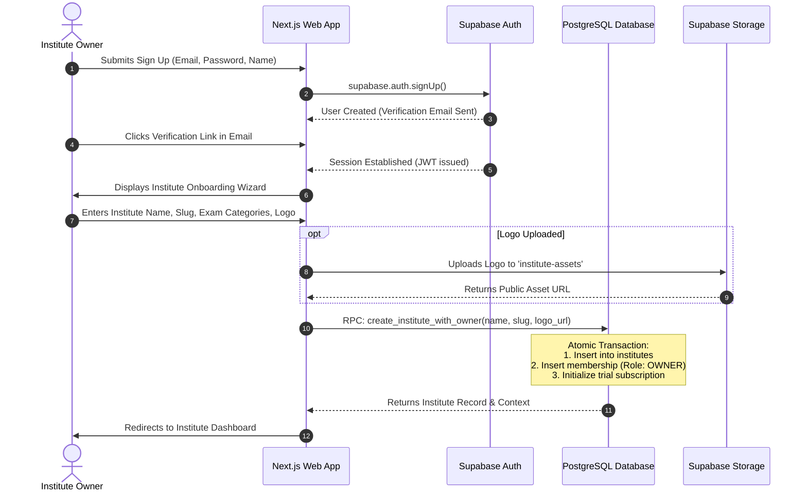
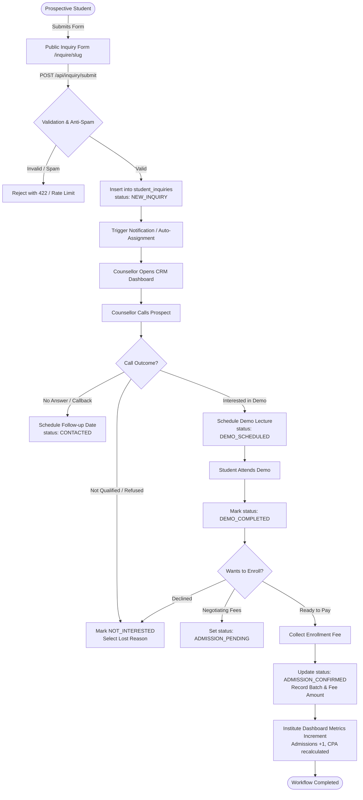
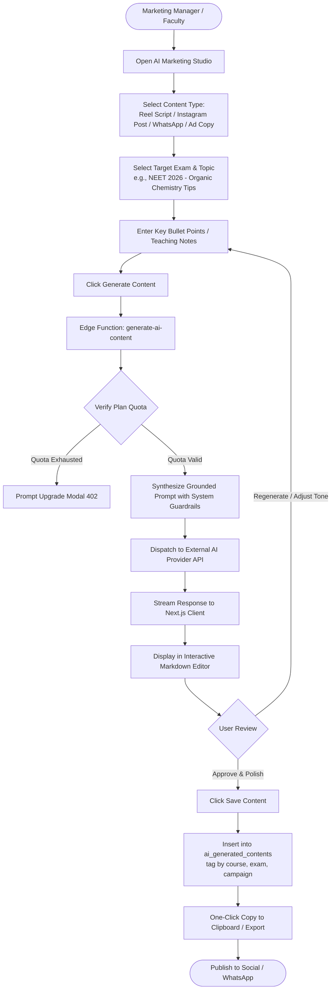
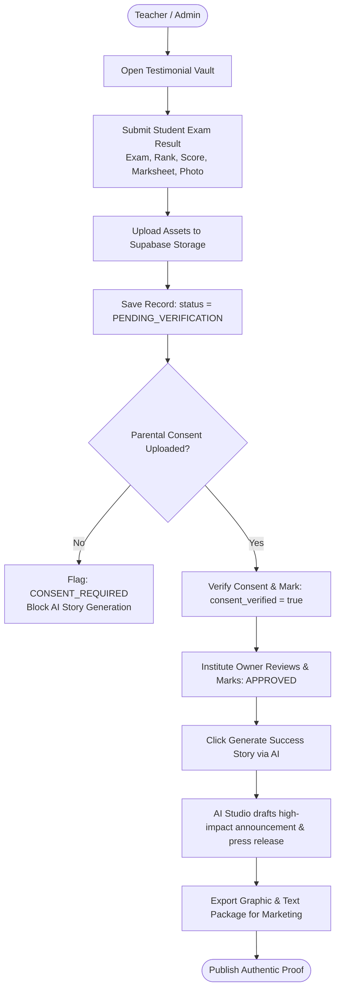
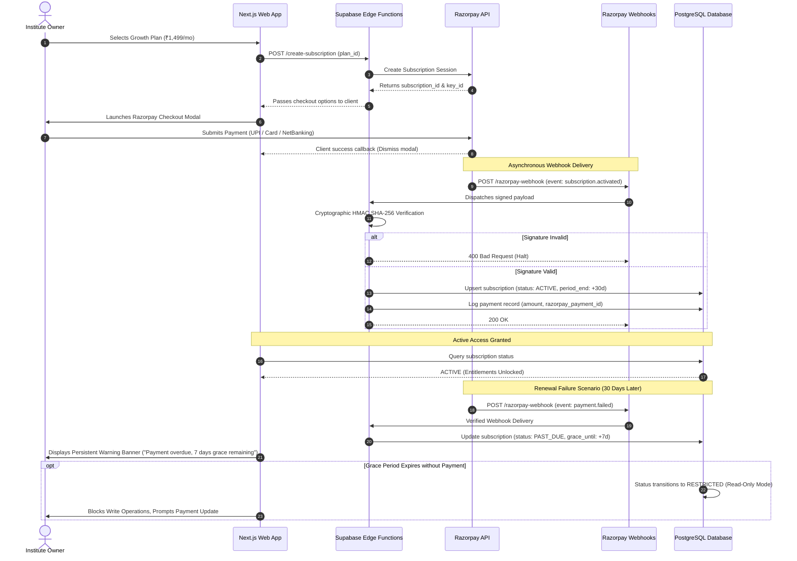
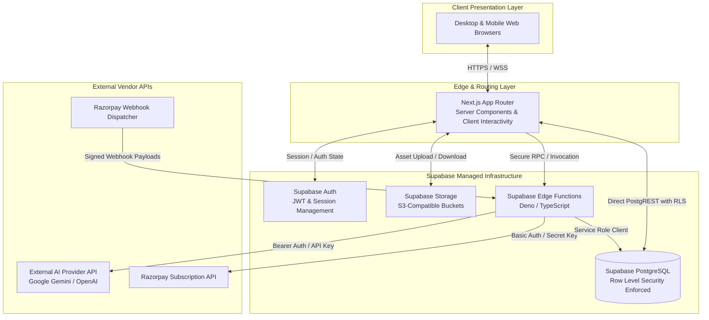
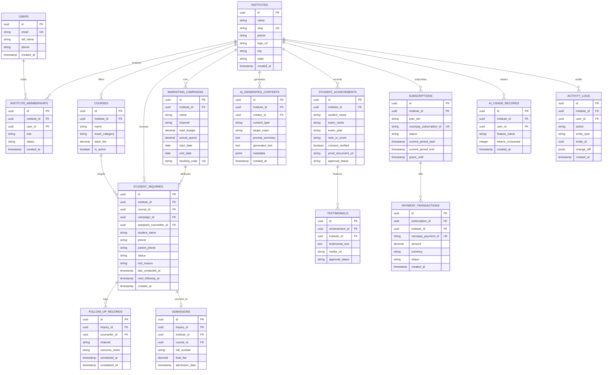
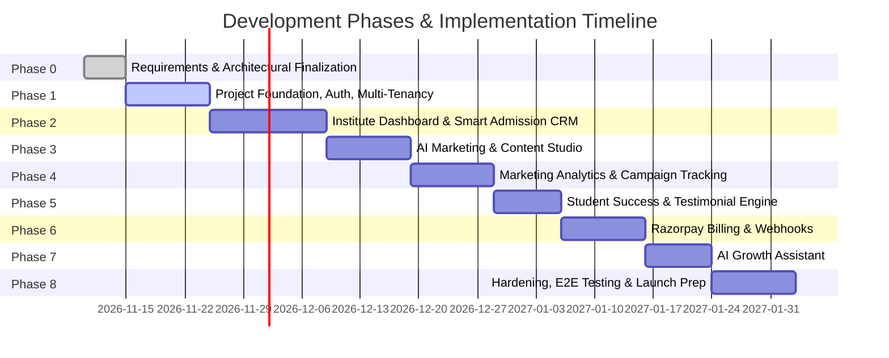

# Master Execution Plan: AI-Powered Coaching Academy Growth & Admissions Platform

**Document Version:** 1.0.0  
**Status:** Execution-Ready Plan (Pending User Milestone Approval)  
**Authoring Roles:** Senior Product Manager, Software Architect, Business Analyst, Technical Project Planner  
**Target Systems:** Next.js (React), Supabase (PostgreSQL, Auth, Storage, Edge Functions), External AI Provider, Razorpay Subscriptions  

---

## Table of Contents
1. [Project Overview](#section-1-project-overview)
2. [Target Audience and User Personas](#section-2-target-audience-and-user-personas)
3. [Product Scope and Feature Breakdown](#section-3-product-scope-and-feature-breakdown)
4. [User Roles and Permission Matrix](#section-4-user-roles-and-permission-matrix)
5. [End-to-End User Workflows](#section-5-end-to-end-user-workflows)
6. [Technical Architecture and Technology Stack](#section-6-technical-architecture-and-technology-stack)
7. [Database and Data Requirements](#section-7-database-and-data-requirements)
8. [API and Integration Requirements](#section-8-api-and-integration-requirements)
9. [Development Roadmap](#section-9-development-roadmap)
10. [Task-Level Execution Backlog](#section-10-task-level-execution-backlog)
11. [Non-Functional Requirements](#section-11-non-functional-requirements)
12. [Testing Strategy](#section-12-testing-strategy)
13. [Risks and Dependencies](#section-13-risks-and-dependencies)
14. [MVP vs. Future Scope](#section-14-mvp-vs-future-scope)
15. [Open Questions and Pending Decisions](#section-15-open-questions-and-pending-decisions)

---

# Section 1: Project Overview

### 1.1 Project Introduction
The **AI-Powered Coaching Academy Growth & Admissions Platform** is a specialized multi-tenant B2B Software-as-a-Service (SaaS) solution engineered for test-preparation academies and coaching institutes. The platform unifies organic marketing content generation, multi-channel student inquiry capture, admission pipeline tracking, verified testimonial amplification, and actionable business intelligence into a single operational hub.

### 1.2 Product Vision & Mission
- **Vision:** To become the standard digital operating system for test-preparation academies, empowering educators to transition from chaotic manual outreach to automated, data-driven student acquisition and pipeline management.
- **Mission:** Dramatically cut the time and cognitive overhead spent on marketing and repetitive follow-ups, allowing institute founders and educators to focus on instructional excellence while maintaining predictable batch enrollment.

### 1.3 Problem Statement
Coaching academies operate in highly competitive local and regional markets with rigid academic batch intake cycles (e.g., JEE, NEET, MHT-CET, UPSC, Foundation courses). They suffer from seven chronic operational bottlenecks:
1. **High Overhead in Content Creation:** Teachers and administrators spend 10–15 hours weekly drafting social media posts, exam breakdown carousels, WhatsApp broadcasts, and promotional banners.
2. **Inquiry Leakage & Fragmented Intake:** Inquiries arrive haphazardly via phone calls, WhatsApp messages, walk-ins, and website contact forms without central consolidation.
3. **Inconsistent Counsellor Follow-Ups:** Lack of automated task assignment results in forgotten prospects, cold leads, and lost enrollment revenue.
4. **Opaque Marketing Return on Investment (ROI):** Founders cannot correlate money spent on meta ads, local pamphlets, or seminars with confirmed student fee collections.
5. **Underutilized Student Social Proof:** Historical top rankers, high percentile scores, and parent testimonials exist as unstructured photos or WhatsApp screenshots rather than reusable marketing assets.
6. **Repetitive Manual Communication:** Staff manually send repetitive demo reminders, schedule confirmations, and fee deadline notices.
7. **Disjointed Business Visibility:** Institute owners lack real-time visibility into conversion funnels, counsellor performance, and upcoming revenue.

### 1.4 Proposed Solution
A consolidated cloud-native platform providing:
- An **AI Marketing & Content Studio** to transform syllabus topics and raw student scores into high-converting social copy, video scripts, and marketing calendars in seconds.
- A **Smart Admission CRM** with stage-gated pipelines (New Inquiry $\rightarrow$ Contacted $\rightarrow$ Interested $\rightarrow$ Demo Scheduled $\rightarrow$ Demo Completed $\rightarrow$ Admission Pending $\rightarrow$ Admission Confirmed $\rightarrow$ Not Interested).
- **Marketing Analytics & Attribution** connecting spend per channel directly to enrolled students.
- A **Student Success & Testimonial Engine** capturing consent-backed achievements and generating verified marketing collateral.
- An **AI Growth Assistant** acting as an on-demand business analyst answering natural language inquiries regarding academy health.

### 1.5 Core Value Proposition
> *"An AI-powered growth platform that helps coaching institutes turn educational content into marketing opportunities, marketing opportunities into student inquiries, and student inquiries into confirmed admissions — while measuring business performance and cost-per-admission at every stage."*

### 1.6 Business Objectives
- Accelerate marketing content throughput by at least $4\times$.
- Decrease inquiry response latency from $>24$ hours to $<15$ minutes via automated acknowledgment and immediate counsellor dispatch.
- Elevate inquiry-to-admission conversion rates by $25\%\text{--}35\%$ through systematic follow-up cadences.
- Provide $100\%$ visibility into Cost Per Inquiry (CPI) and Cost Per Admission (CPA).

---

# Section 2: Target Audience and User Personas

### 2.1 Target Market Segments
The platform primarily serves Indian and regional test-prep academies operating recurring batches:
- **Engineering Entrance:** JEE Main, JEE Advanced, MHT-CET, BITSAT, State CETs.
- **Medical Entrance:** NEET-UG, NEET-PG.
- **Civil Services & Government Exams:** UPSC CSE, State PSCs (MPSC, KPSC, etc.), SSC CGL, Banking (IBPS, SBI PO), Railways (RRB).
- **Secondary & Foundation Academies:** Grades 8–10 Olympiads, NTSE, CBSE/ICSE Board Prep.
- **Commerce & Law:** CA Foundation, CLAT, IPMAT.

---

### 2.2 Detailed User Personas

```
+-----------------------------------------------------------------------------------+
| PERSONA 1: The Academy Owner / Founder ("Director Rajan")                         |
+-----------------------------------------------------------------------------------+
| Responsibilities : Overall academy profitability, batch sizing, brand trust.      |
| Core Pain Points : Blind to which ads produce actual enrollments; counsellor      |
|                    complacency; constant worry over empty batch seats.            |
| Primary Goals    : Predictable cash flow, full batch capacity, low customer       |
|                    acquisition cost (CAC).                                        |
| Platform Modules : Institute Dashboard, Analytics, AI Growth Assistant, Billing.  |
| Direct Value     : Instant visibility into CAC, CPA, conversion rates, and revenue|
|                    run-rates without chasing administrative staff.                |
+-----------------------------------------------------------------------------------+

+-----------------------------------------------------------------------------------+
| PERSONA 2: The Institute Administrator / Centre Manager ("Pooja Sharma")          |
+-----------------------------------------------------------------------------------+
| Responsibilities : Day-to-day operations, batch scheduling, staff allocation.     |
| Core Pain Points : Managing physical registers/spreadsheets; manual intake errors;|
|                    coordinating between teachers, counsellors, and parents.       |
| Primary Goals    : Smooth operational execution, zero missed student records.     |
| Platform Modules : User Management, CRM Assignment, Course Setup, Audit Logs.     |
| Direct Value     : Centralized student intake, automated counsellor assignment,   |
|                    and structured operational tracking.                           |
+-----------------------------------------------------------------------------------+

+-----------------------------------------------------------------------------------+
| PERSONA 3: The Admission Counsellor ("Amit Verma")                                |
+-----------------------------------------------------------------------------------+
| Responsibilities : Calling prospective leads, booking demo lectures, closing fees.|
| Core Pain Points : Forgetting scheduled callbacks; manual WhatsApp messaging;     |
|                    prospects going cold due to delayed contact.                   |
| Primary Goals    : Meeting monthly admission targets, organized task lists.       |
| Platform Modules : Smart Admission CRM, Follow-up Manager, Communication Studio.  |
| Direct Value     : Clear daily agenda of due follow-ups, one-click WhatsApp logs,  |
|                    and complete prospect interaction history.                     |
+-----------------------------------------------------------------------------------+

+-----------------------------------------------------------------------------------+
| PERSONA 4: The Marketing Manager / Growth Specialist ("Kavita Nair")              |
+-----------------------------------------------------------------------------------+
| Responsibilities : Social media campaigns, pamphlet distribution, Meta/Google ads.|
| Core Pain Points : Creative burnout drafting daily exam tips and banners; cannot  |
|                    prove which campaigns drove actual cash at the front desk.     |
| Primary Goals    : Generating low-cost qualified inquiries, maintaining brand.    |
| Platform Modules : AI Content Studio, Campaign Tracker, Testimonial Vault.        |
| Direct Value     : Generate 30 days of exam-specific captions, scripts, and       |
|                    success stories in 30 minutes; track conversion per ad UTM.    |
+-----------------------------------------------------------------------------------+

+-----------------------------------------------------------------------------------+
| PERSONA 5: The Senior Teacher / Subject Faculty ("Prof. Kulkarni")                |
+-----------------------------------------------------------------------------------+
| Responsibilities : Curriculum delivery, student doubt resolution, exam results.   |
| Core Pain Points : Lack of time to help marketing write study tips; student       |
|                    successes go unnoticed.                                        |
| Primary Goals    : Showcasing student achievements, sharing pedagogical tips.     |
| Platform Modules : Content Studio (Repurposing), Student Success Vault.           |
| Direct Value     : Converts raw lecture outlines into engaging educational reels   |
|                    and posts with zero extra effort.                              |
+-----------------------------------------------------------------------------------+

+-----------------------------------------------------------------------------------+
| BENEFICIARIES: Students & Parents ("Aarav & Mr. Patel")                          |
+-----------------------------------------------------------------------------------+
| Interaction      : Prospective students filling web intake forms; parents         |
|                    evaluating academy credentials and past rankers.               |
| Experience       : Immediate inquiry confirmation, transparent demo reminders,    |
|                    access to verified authentic student testimonials.             |
+-----------------------------------------------------------------------------------+
```

---

# Section 3: Product Scope and Feature Breakdown

The platform is partitioned into 10 cohesive functional modules:

```
+----------------------------------------------------------------------------------+
|                    COACHING ACADEMY GROWTH PLATFORM MODULES                      |
+----------------------------------------------------------------------------------+
| [Mod 1] Auth & Onboarding         | [Mod 2] Institute Dashboard                  |
| [Mod 3] AI Marketing Studio       | [Mod 4] Smart Admission CRM                  |
| [Mod 5] Marketing Analytics       | [Mod 6] Student Success & Testimonials       |
| [Mod 7] Communication Automation  | [Mod 8] AI Growth Assistant                  |
| [Mod 9] Subscription & Billing    | [Mod 10] Performance Insights (Future Scope) |
+----------------------------------------------------------------------------------+
```

---

### Module 1: User Authentication & Institute Onboarding
- **Module Objective:** Establish verified user identity, self-service institute workspace registration, secure session tokens, and invite-based staff onboarding.
- **Detailed Functional Requirements:**
  - Support email/password registration with mandatory email verification via Supabase Auth.
  - Institute Creation Wizard: Institute legal name, primary phone, city, state, target examination categories (JEE, NEET, etc.), logo upload.
  - Multi-Tenant Provisioning: Automatic generation of a unique `institute_id` with owner membership binding in a single database transaction.
  - Staff Invitation Engine: Generate time-limited (7-day) invitation magic links or tokens granting specific roles (Administrator, Counsellor, Marketing Manager, Faculty).
  - Profile Management: Update personal contact details, password reset, avatar upload.
- **Access Roles:** Unauthenticated users (signup), All authenticated roles (profile), Owner/Admin (staff invitation).
- **Inputs & Outputs:**
  - *Inputs:* Email, secure password, institute details, invitation emails + roles.
  - *Outputs:* JWT session token, institute workspace context, active membership record.
- **Dependencies:** Supabase Auth, PostgreSQL schema (`institutes`, `users`, `institute_memberships`), Supabase Storage (logos).
- **Business Rules:**
  - An owner cannot delete their institute if active subscriptions exist without explicit cancellation.
  - Each staff member can only accept an invitation matching their authenticated email.
  - During MVP, a single user is associated with one active institute workspace to prevent session bleeding.
- **Acceptance Criteria:**
  - User can register, verify email, create an institute, and arrive at the dashboard in $<2$ minutes.
  - Unauthenticated requests to protected endpoints return `401 Unauthorized`.
  - Cross-tenant URL tampering (changing `institute_id`) returns `403 Forbidden` via Row Level Security.

---

### Module 2: Institute Dashboard
- **Module Objective:** Provide high-altitude operational visibility, surfacing critical real-time KPIs, pending follow-ups, inquiry velocity, and recent activity.
- **Detailed Functional Requirements:**
  - Display primary metric summary cards: Total Inquiries (Month-to-Date), Confirmed Admissions, Conversion Rate ($\% \text{ admissions} / \text{inquiries}$), Cost Per Admission (CPA).
  - Quick-action shortcuts: "Create Lead", "Generate AI Content", "Schedule Follow-up", "Add Achievement".
  - "Requires Immediate Action" Drawer: Inquiries past their follow-up due date, unassigned incoming leads.
  - Visual charts: 30-day inquiry velocity line chart, source breakdown donut chart, funnel conversion bar chart.
  - Recent activity feed logging status transitions and counsellor notes.
- **Access Roles:** Owner (Full visibility + Financials), Admin (Operational KPIs), Counsellor (Personal inquiry KPIs only), Marketer (Campaign KPIs only).
- **Inputs & Outputs:**
  - *Inputs:* Date range filter (Today, 7D, 30D, Current Month, Custom Range), Course Filter.
  - *Outputs:* Aggregated metrics, formatted time-series data, alert lists.
- **Dependencies:** Module 1 (Auth), Module 4 (CRM Data), Module 5 (Analytics Aggregations).
- **Business Rules:**
  - Financial data (revenue, CPA, ad spend) is strictly redacted for Counsellors and Faculty.
  - Aggregations must be calculated using the tenant's localized timezone (`Asia/Kolkata` default).
- **Acceptance Criteria:**
  - Dashboard loads initial paint in $<1.2$ seconds under normal network conditions.
  - Metrics reflect database updates immediately upon page refresh or mutation cache invalidation.

---

### Module 3: AI Marketing & Content Studio
- **Module Objective:** Empower non-technical marketing teams and teachers to generate high-converting, exam-tailored promotional copy, video scripts, and marketing calendars.
- **Detailed Functional Requirements:**
  - **Prompt Studio with Pre-Engineered Prompts:**
    - Instagram Captions & Hashtag generators tailored to specific exams (NEET motivation, JEE problem-solving tips).
    - Short-form Video Scripts (15s, 30s, 60s Reel/YouTube Shorts formats with visual cues, voiceover scripts, and text overlays).
    - WhatsApp Broadcast messages (Urgent batch starting alerts, Early bird discounts, Scholarship test reminders).
    - Course Announcement campaigns and Ad Copy (Meta & Google Search formats).
  - **Content Repurposing Engine:** Input raw syllabus notes, formulas, or lecture key takeaways and transform into 5 distinct micro-content snippets (Tip of the Day, Formula Breakdown, Quiz Question, Parent Advice, Student Motivation).
  - **Content Editor & Workspace:** In-app markdown/text editor to polish, re-generate variations, format bullet points, and append standard institute disclaimers.
  - **Content Vault & Organization:** Tag, categorize by exam, course, and campaign; archive or star high-performing copy.
  - **Copy-to-Clipboard & Export:** Instant format export (plain text, formatted WhatsApp markdown with bolding/emojis).
- **Access Roles:** Owner, Admin, Marketing Manager, Faculty (Read/Generate/Draft).
- **Inputs & Outputs:**
  - *Inputs:* Target exam, course title, key highlights, tone (Urgent, Inspiring, Academic, Authoritative), raw notes, target length.
  - *Outputs:* Structured draft copy, video storyboard, hashtags, WhatsApp formatting.
- **Dependencies:** Supabase Edge Functions (`generate-ai-content`), External AI Provider API, PostgreSQL (`ai_generated_contents`, `ai_usage_logs`).
- **Business Rules:**
  - Generation calls must enforce monthly plan token/credit quotas. If quota exhausted, block generation and prompt plan upgrade.
  - Prompts must contain system instructions prohibiting the generation of false claims, fake ranks, or unverified regulatory guarantees.
- **Acceptance Criteria:**
  - Content generation stream starts within 2.5 seconds of prompt submission.
  - Saved content persists in the Content Vault and retains formatting tags.
  - Failed AI API calls trigger clear user messaging with automatic credit reimbursement/non-decrement.

---

### Module 4: Smart Admission CRM
- **Module Objective:** Systematically shepherd prospective students from first touchpoint through consultation, demo lectures, and fee payment without inquiry leakage.
- **Detailed Functional Requirements:**
  - **Multi-Channel Lead Intake:**
    - Embeddable Public Inquiry Form endpoint (`/inquire/[institute_slug]`) with CSRF protection and rate limiting.
    - Manual Inquiry Entry modal for walk-in visits and direct phone calls.
  - **Inquiry Profile Management:** Student full name, primary WhatsApp phone number, parent name/contact, school/college, current grade, target exam/course, lead source (Meta Ads, Pamphlet, Walk-in, Website, Referral).
  - **Kanban Pipeline & Table Views:** Drag-and-drop status stages:
    1. `NEW_INQUIRY`
    2. `CONTACTED`
    3. `INTERESTED`
    4. `DEMO_SCHEDULED`
    5. `DEMO_COMPLETED`
    6. `ADMISSION_PENDING`
    7. `ADMISSION_CONFIRMED`
    8. `NOT_INTERESTED` (with required lost reason: Fee too high, Location far, Chose competitor, Timing conflict, Other)
  - **Counsellor Assignment:** Manual assignment or round-robin auto-dispatch across active counsellors.
  - **Follow-Up Management:** Schedule follow-up date and time with mandatory notes; set reminder alerts.
  - **Activity Timeline:** Chronological audit trail of all status transitions, notes logged, calls made, and SMS/WhatsApp messages sent.
  - **Admission Conversion:** Converting a lead to `ADMISSION_CONFIRMED` allows capturing enrolled batch, admission roll number, and committed fee amount.
- **Access Roles:** Owner, Admin, Admission Counsellor (assigned leads or all institute leads based on permission).
- **Inputs & Outputs:**
  - *Inputs:* Student profile data, status changes, interaction notes, follow-up timestamps, lost reasons.
  - *Outputs:* Real-time Kanban board, filtered tabular lists, counsellor task agendas, admission records.
- **Dependencies:** Module 1 (Auth/Tenancy), Module 2 (Dashboard metrics), Module 5 (Attribution).
- **Business Rules:**
  - Phone numbers must be validated to Indian 10-digit format (`+91` standard).
  - Moving a lead to `NOT_INTERESTED` requires a mandatory structured drop-down reason.
  - A lead cannot jump directly to `ADMISSION_CONFIRMED` without entering an enrollment fee figure and course selection.
- **Acceptance Criteria:**
  - Dragging a lead between stages updates status in database in $<300\text{ms}$.
  - Overdue follow-up badges trigger visibly on both the CRM Kanban card and Counsellor Agenda.
  - Public inquiry submission automatically creates a lead with `source = 'WEBSITE_FORM'` and assigns to the institute.

---

### Module 5: Marketing Analytics & Campaign Tracking
- **Module Objective:** Measure the commercial efficacy of marketing campaigns, attributing student inquiries and enrollments back to marketing expenditure to calculate true ROI.
- **Detailed Functional Requirements:**
  - **Campaign Registry:** Create and log marketing campaigns (e.g., "NEET Crash Course 2026 Meta Ads", "City Center Hoarding Q1", "School Seminar DPS").
  - **Campaign Metadata:** Channel (Meta, Google, Print, Hoarding, Referral, Seminar), Start/End dates, Total Budget, Actual Spend.
  - **Source Tracking & UTM Links:** Generate unique lead source tracking tags and URL query parameters for digital campaigns (`?utm_source=meta&utm_campaign=neet_crash`).
  - **Financial Metrics Engine:**
    - Cost Per Inquiry (CPI): $\text{Total Campaign Spend} / \text{Total Inquiries Attributed}$.
    - Cost Per Admission (CPA): $\text{Total Campaign Spend} / \text{Confirmed Admissions Attributed}$.
    - Campaign Conversion Rate: $(\text{Confirmed Admissions} / \text{Total Inquiries}) \times 100$.
    - Attributed Revenue: Total collected fees from admissions linked to the campaign.
    - Return on Ad Spend (ROAS): $\text{Attributed Revenue} / \text{Total Campaign Spend}$.
  - **Comparative Visual Analytics:** Side-by-side bar charts comparing CAC across channels.
- **Access Roles:** Owner (Full access), Admin (Full access), Marketing Manager (View and Manage spend/campaigns).
- **Inputs & Outputs:**
  - *Inputs:* Campaign names, channel selections, cost inputs, link generator params.
  - *Outputs:* CPI, CPA, ROAS, visual performance reports, comparative breakdown tables.
- **Dependencies:** Module 4 (CRM lead attribution), Module 2 (Dashboard feeds).
- **Business Rules:**
  - If spend is zero or undefined, CPI and CPA must display as $\text{N/A}$ rather than dividing by zero.
  - An inquiry's attribution is immutable once confirmed to prevent retroactive ROI distortion unless edited by Institute Owner.
- **Acceptance Criteria:**
  - Updating a campaign's spend immediately updates the computed CPI and CPA across dashboards.
  - Filtering by date range accurately constrains both the lead denominator and expenditure calculations.

---

### Module 6: Student Success & Testimonial Management
- **Module Objective:** Systematize the collection, parental consent verification, and promotional weaponization of student ranks, examination marks, and alumni testimonials.
- **Detailed Functional Requirements:**
  - **Achievement Repository:** Store student name, exam year, examination type (JEE Adv, NEET, etc.), score, percentile, All India Rank (AIR), State Rank, roll number, admission year.
  - **Evidence & Asset Storage:** Upload mark sheets, rank verification letters, student headshots, and video testimonials to dedicated Supabase Storage buckets.
  - **Consent Tracking System:** Digital verification checklist: Signed parent consent on file (Yes/No), media release permitted (Yes/No), consent document upload.
  - **AI Success Story Generator:** One-click generation of:
    - High-impact Instagram congratulatory announcement captions.
    - Press release drafts for local newspapers.
    - Long-form website interview/case study articles detailing student study strategies.
  - **Approval Governance:** Explicit workflow: `DRAFT` $\rightarrow$ `PENDING_VERIFICATION` $\rightarrow$ `APPROVED_FOR_PUBLICATION` $\rightarrow$ `ARCHIVED`.
- **Access Roles:** Owner, Admin, Marketing Manager, Faculty (Submit achievements).
- **Inputs & Outputs:**
  - *Inputs:* Student credentials, exam ranks, media files, consent checkboxes.
  - *Outputs:* Verified achievement records, AI-drafted victory posts, filtered testimonial archive.
- **Dependencies:** Module 1 (Tenancy), Supabase Storage (`testimonials`, `achievements`), Module 3 (AI Studio).
- **Business Rules:**
  - AI promotion generation is disabled until the record has `consent_verified = true`.
  - Student roll numbers and phone numbers are automatically redacted from public promotional drafts generated by AI.
- **Acceptance Criteria:**
  - Media assets upload securely and generate authenticated time-limited preview URLs for private reviews.
  - Unapproved testimonials cannot be queried by public API endpoints.

---

### Module 7: Communication & Follow-up Automation
- **Module Objective:** Eliminate missed student connections via automated acknowledgment triggers, scheduled counsellor follow-up alerts, and pre-formatted messaging templates.
- **Detailed Functional Requirements:**
  - **Message Template Manager:** Manage standardized notification templates with dynamic variables (`{{student_name}}`, `{{course_name}}`, `{{institute_name}}`, `{{demo_date}}`, `{{counsellor_phone}}`).
  - **Event-Driven Triggers (Internal / Simulated for MVP):**
    - Trigger 1: Instant acknowledgment upon new inquiry submission.
    - Trigger 2: Due follow-up reminder sent to counsellor dashboard/notification list.
    - Trigger 3: Demo lecture confirmation reminder 24 hours prior.
  - **One-Click WhatsApp Dispatch:** In-app button to launch WhatsApp Web/Desktop with pre-filled, variable-replaced message text directly targeting the student's phone.
  - **Communication Audit Log:** Record every communication attempt, channel utilized (WhatsApp, Phone Call, SMS, Email), timestamp, and counsellor notes.
- **Access Roles:** Owner, Admin, Counsellor.
- **Inputs & Outputs:**
  - *Inputs:* Template text, variable bindings, communication dispatch clicks, logged call notes.
  - *Outputs:* Rendered message copy, logged communication histories, counsellor reminder queues.
- **Dependencies:** Module 4 (CRM lead records), Module 1 (Auth).
- **Business Rules:**
  - During MVP, WhatsApp messages are launched via client-side intent (`https://wa.me/91XXXXXXXXXX?text=...`) to avoid third-party BSP API dependencies until Phase 2.
  - All manual calls and offline interactions must require counsellor call notes to be entered before closing the task.
- **Acceptance Criteria:**
  - Clicking "Send WhatsApp" correctly formats and encodes all message parameters.
  - Communication log updates the student's activity history immediately.

---

### Module 8: AI Growth Assistant
- **Module Objective:** Act as an on-demand virtual Chief Operating Officer and Business Analyst, translating complex database metrics into plain-English strategic recommendations.
- **Detailed Functional Requirements:**
  - **Chat Interface:** Interactive conversational interface grounded in the institute's real operational metrics.
  - **Grounded Analytics Queries:**
    - "Summarize our inquiry velocity this month compared to last month."
    - "Which counsellor has the highest demo conversion rate?"
    - "Which marketing channel produced the lowest CPA for NEET courses?"
    - "How many inquiries have been waiting without follow-up for $>48$ hours?"
  - **Strategic Recommendation Engine:**
    - Identifies underperforming campaigns and recommends budget reallocations.
    - Suggests upcoming exam milestones to prepare marketing content 3 weeks in advance.
  - **Context-Bound Prompt Synthesis:** Server-side function compiles sanitized aggregate numbers (no PII) into the LLM context to ground all responses in strict fact.
- **Access Roles:** Institute Owner, Institute Administrator.
- **Inputs & Outputs:**
  - *Inputs:* Natural language queries from institute leaders.
  - *Outputs:* Data-grounded responses, analytical summaries, actionable bullet points.
- **Dependencies:** Supabase Edge Functions (`growth-assistant`), External AI Provider, Module 4 & 5 Aggregations.
- **Business Rules:**
  - The AI assistant must decline to answer questions outside the institute's data scope (no hallucinated external claims).
  - PII (student phone numbers, student names) must be stripped from context before sending data to external LLMs.
- **Acceptance Criteria:**
  - Assistant answers basic metric queries with mathematical precision matching database records.
  - Counsellors and Faculty attempting to access the Growth Assistant receive `403 Forbidden`.

---

### Module 9: Subscription & Billing Management
- **Module Objective:** Manage SaaS monetization, enforce plan entitlements, collect recurring fees via Razorpay, and handle the entire subscription lifecycle.
- **Detailed Functional Requirements:**
  - **Pricing Tier Matrix:**
    - **Starter (₹499/mo):** 1 Admin, 1 Counsellor, 200 Inquiries/mo, 50 AI generations/mo.
    - **Growth (₹1,499/mo):** 3 Staff, 1,000 Inquiries/mo, 250 AI generations/mo, Marketing Analytics.
    - **Professional (₹2,999/mo):** Unlimited Staff, 5,000 Inquiries/mo, 1,000 AI generations/mo, AI Growth Assistant, Dedicated Support.
  - **Checkout Integration:** Client-side Razorpay modal triggered via server-generated `order_id` or `subscription_id`.
  - **Webhook Processing Engine:** Edge Function listening to Razorpay webhook events:
    - `subscription.authenticated`
    - `subscription.activated`
    - `subscription.charged`
    - `subscription.halted`
    - `subscription.cancelled`
    - `payment.failed`
  - **Entitlement Enforcement:** Server-side guard checking active subscription status before permitting AI generation, CRM export, or user addition.
  - **Billing Portal:** Download tax invoices, view past transactions, manage card/UPI mandate, initiate tier upgrade/downgrade.
- **Access Roles:** Institute Owner only.
- **Inputs & Outputs:**
  - *Inputs:* Selected tier, billing cycle (Monthly/Annual), Razorpay checkout payment tokens.
  - *Outputs:* Signed subscription order, verified invoice, updated entitlement state.
- **Dependencies:** Supabase Edge Functions (`razorpay-webhook`), Razorpay SDK/APIs, PostgreSQL (`subscriptions`, `payments`).
- **Business Rules:**
  - Webhooks must verify the cryptographic HMAC SHA-256 signature using `RAZORPAY_WEBHOOK_SECRET`.
  - A 7-day grace period is granted upon `payment.failed` before restricting the institute workspace to read-only mode.
- **Acceptance Criteria:**
  - Simulating a successful webhook payload updates institute status to `ACTIVE` in $<500\text{ms}$.
  - Tampered or unsigned webhook requests return `400 Bad Request` and make zero database modifications.

---

### Module 10: Student Performance Insights (Future Scope / Phase 3)
- **Module Objective:** Bridge student academic success back into marketing by tracking internal test series results, batch averages, and weak subject areas.
- **Detailed Functional Requirements:**
  - Batch-wise mock test mark entry (Physics, Chemistry, Maths, Biology).
  - Percentile and rank distribution generation within the academy.
  - Automated detection of standout achievers for instant promotion in Module 6.
  - Academic report card PDF generator with academy branding.
- **Access Roles:** Owner, Admin, Faculty.
- **Dependencies:** Core CRM, Testimonial Vault.
- **Status:** **Explicitly Out of MVP Scope**; designed for architectural compatibility in Phase 3.

---

# Section 4: User Roles and Permission Matrix

### 4.1 Role Definitions
1. **Platform Super Admin:** Internal platform operator managing all institute tenants, platform-wide billing, system health, and global LLM configurations.
2. **Institute Owner:** The legal/commercial owner of the coaching academy. Has supreme authority over billing, staff memberships, revenue reports, and institute settings.
3. **Institute Administrator:** Operations manager running the center. Manages courses, leads, counsellors, and campaigns, but cannot delete the institute or alter Razorpay bank billing details.
4. **Admission Counsellor:** Front-line sales and consultation staff. Manages assigned student leads, schedules demo classes, updates follow-up logs, and records conversions.
5. **Marketing Manager:** Growth specialist managing ad campaigns, creating AI copy, managing the testimonial vault, and monitoring lead acquisition metrics.
6. **Teacher / Faculty:** Academic instructor who submits educational notes for repurposing and logs student test scores and achievements.

---

### 4.2 Comprehensive Role-Permission Matrix

| Resource / Action | Platform Super Admin | Institute Owner | Institute Admin | Admission Counsellor | Marketing Manager | Teacher / Faculty |
|---|:---:|:---:|:---:|:---:|:---:|:---:|
| **Institute Management** | | | | | | |
| View Institute Profile | All | Own | Own | Own | Own | Own |
| Edit Institute Profile / Branding | Yes | Yes | Yes | No | No | No |
| Delete Institute Workspace | Yes | Yes (Guarded) | No | No | No | No |
| **User & Staff Management** | | | | | | |
| Invite Staff Members | Yes | Yes | Yes | No | No | No |
| Change Member Roles | Yes | Yes | No | No | No | No |
| Remove Staff Members | Yes | Yes | Yes (Non-Owners) | No | No | No |
| **Subscription & Billing** | | | | | | |
| View Billing & Invoices | All | Yes | No | No | No | No |
| Upgrade / Cancel Subscription | Yes | Yes | No | No | No | No |
| Access Razorpay Configuration | Platform Only | Webhook Only | No | No | No | No |
| **Smart Admission CRM** | | | | | | |
| View All Institute Leads | All | Yes | Yes | If Permitted | Read-Only | No |
| View Assigned Leads Only | N/A | N/A | N/A | Yes | N/A | No |
| Create / Edit Inquiries | Yes | Yes | Yes | Yes | No | No |
| Delete Inquiries | Yes | Yes | No | No | No | No |
| Assign Counsellors | Yes | Yes | Yes | No | No | No |
| Log Follow-ups & Notes | Yes | Yes | Yes | Yes | No | No |
| Confirm Admission (Close Deal) | Yes | Yes | Yes | Yes | No | No |
| Export Lead Database (CSV) | Yes | Yes | No | No | No | No |
| **AI Content Studio** | | | | | | |
| Generate Marketing Content | Yes | Yes | Yes | No | Yes | Draft Only |
| Edit & Save Content | Yes | Yes | Yes | No | Yes | Yes |
| Delete Saved Content | Yes | Yes | Yes | No | Yes | No |
| View Content History | All | Yes | Yes | No | Yes | Own Drafts |
| **Campaigns & Analytics** | | | | | | |
| View Dashboard KPIs | Platform Global | Full Financial | Full Operational | Personal Leads | Campaign ROI | No |
| Create / Manage Campaigns | Yes | Yes | Yes | No | Yes | No |
| Input Marketing Spend Data | Yes | Yes | Yes | No | Yes | No |
| View Financial ROI (CPA/ROAS) | All | Yes | Yes | No | Yes | No |
| **Student Success & Testimonials**| | | | | | |
| Submit Achievement Record | Yes | Yes | Yes | No | Yes | Yes |
| Upload Consent Documents | Yes | Yes | Yes | No | Yes | No |
| Approve Testimonial Publication | Yes | Yes | Yes | No | No | No |
| Delete Testimonials | Yes | Yes | No | No | No | No |
| **AI Growth Assistant** | | | | | | |
| Query Growth Assistant | Yes | Yes | Yes | No | No | No |
| **System Audit Logs** | | | | | | |
| View Security & Mutation Logs | All | Yes | Yes | No | No | No |

---

### 4.3 Tenant Data Isolation Guarantee
Every single table holding business data contains an `institute_id UUID NOT NULL` foreign key column pointing to `institutes(id)`. 

PostgreSQL Row Level Security (RLS) is enabled across all tables using the following canonical security pattern:
```sql
CREATE POLICY tenant_isolation_policy ON [table_name]
FOR ALL
USING (
  institute_id IN (
    SELECT m.institute_id 
    FROM institute_memberships m 
    WHERE m.user_id = auth.uid() 
      AND m.status = 'ACTIVE'
  )
);
```
No database client can query, mutate, or delete records belonging to another institute, even if the application code attempts to pass an unauthorized `institute_id`.

---

# Section 5: End-to-End User Workflows

### 5.1 Institute Registration & Onboarding Workflow



---

### 5.2 Student Inquiry to Confirmed Admission Workflow



---

### 5.3 AI Marketing Content Generation Workflow



---

### 5.4 Student Success Story & Verified Testimonial Workflow



---

### 5.5 Marketing Campaign Tracking & Attribution Workflow


---

### 5.6 Subscription Purchase, Webhook & Expiry Lifecycle



---

# Section 6: Technical Architecture and Technology Stack

### 6.1 Architectural Topology
The platform is designed around a modern, decoupled Jamstack/BaaS topology leveraging Next.js (React) on the presentation layer, Supabase for data, identity, and serverless compute, with hardened boundary gateways for AI and payment execution.



---

### 6.2 Component Responsibilities & Confirmation Status

| Technology Component | Selection | Responsibility | Architecture Status |
|---|---|---|---|
| **Frontend Framework** | **Next.js (React)** | SSR for public intake/landing pages, SPA Client Components for dashboards, CRM Kanban, and AI editors. | **Confirmed** |
| **Authentication** | **Supabase Auth** | User authentication, token issuance, session refresh, password resets, role claims. | **Confirmed** |
| **Database** | **Supabase PostgreSQL** | Relational data persistence, Row Level Security, relational constraints, aggregate views, audit trails. | **Confirmed** |
| **File Storage** | **Supabase Storage** | S3-compatible storage for institute logos, mark sheets, rank certificates, and testimonial videos. | **Confirmed** |
| **Backend Functions** | **Supabase Edge Functions** | Server-side Deno runtime handling external AI proxying, payment creation, and webhook signature verification. | **Confirmed** |
| **Payment Gateway** | **Razorpay** | Subscription processing, recurring UPI autopay/cards, payment link generation, invoice receipts. | **Confirmed** |
| **Payment Webhooks** | **Razorpay Webhooks** | Out-of-band notification of subscription states (`activated`, `charged`, `halted`, `failed`). | **Confirmed** |
| **AI LLM Engine** | **External AI API** | Natural language synthesis, marketing copy generation, content repurposing, data-grounded growth queries. | **Pending Provider Finalization** (OpenAI vs. Gemini) |
| **Communication Gateway** | **Client Intent (MVP) / WhatsApp BSP (P2)** | Message dispatching to student WhatsApp accounts. | **MVP Confirmed (Intent), Phase 2 Pending Provider** |
| **Email Gateway** | **Transactional SMTP / Resend** | Verification emails, password resets, overdue alerts. | **Pending Selection** |

---

# Section 7: Database and Data Requirements

### 7.1 Conceptual Entity Relationship Diagram (ERD)



---

### 7.2 Entity Directory & Access Constraints

1. **`institutes`**:
   - *Purpose:* Multi-tenant root account representing a distinct coaching academy.
   - *Key Fields:* `id`, `name`, `slug` (unique vanity URL identifier), `phone`, `city`, `state`, `logo_url`, `created_at`.
   - *Ownership & Access:* Accessible only to members linked via `institute_memberships`.
2. **`users` & `institute_memberships`**:
   - *Purpose:* Maps authenticated identities to institutes with explicit permissions (`OWNER`, `ADMIN`, `COUNSELLOR`, `MARKETER`, `FACULTY`).
   - *Key Fields:* `user_id`, `institute_id`, `role`, `status` (`ACTIVE`, `INVITED`, `SUSPENDED`).
   - *Ownership & Access:* Users can view their own profile; Owners/Admins can view and mutate memberships.
3. **`courses`**:
   - *Purpose:* Catalogs academic offerings (e.g., "2-Year Comprehensive JEE 2027").
   - *Key Fields:* `id`, `institute_id`, `name`, `exam_category`, `base_fee`, `is_active`.
   - *Ownership & Access:* Institute-isolated; viewable by all members, editable by Owner/Admin.
4. **`student_inquiries`**:
   - *Purpose:* Tracks prospect details through the admission conversion lifecycle.
   - *Key Fields:* `id`, `institute_id`, `course_id`, `campaign_id`, `assigned_counsellor_id`, `student_name`, `phone`, `parent_phone`, `status`, `lost_reason`, `next_followup_at`.
   - *Ownership & Access:* Institute-isolated; Counsellors view permitted leads; Admins/Owners view all.
5. **`follow_up_records`**:
   - *Purpose:* Logs chronological counsellor outreach history.
   - *Key Fields:* `id`, `inquiry_id`, `counsellor_id`, `channel` (Call, WhatsApp, In-Person), `outcome_notes`, `completed_at`.
   - *Ownership & Access:* Readable by institute staff; creatable by assigned counsellor or admins.
6. **`admissions`**:
   - *Purpose:* Immutable record of converted student enrollments.
   - *Key Fields:* `id`, `inquiry_id`, `institute_id`, `course_id`, `roll_number`, `final_fee`, `admission_date`.
   - *Ownership & Access:* Read/Write for Owner, Admin, Counsellor. Financial metrics visible to Owner/Admin only.
7. **`marketing_campaigns`**:
   - *Purpose:* Registers marketing channels, budgets, and actual expenditures for attribution.
   - *Key Fields:* `id`, `institute_id`, `name`, `channel`, `total_budget`, `actual_spend`, `start_date`, `end_date`, `tracking_code`.
   - *Ownership & Access:* Visible to Owner, Admin, Marketer.
8. **`ai_generated_contents`**:
   - *Purpose:* Stores drafted and approved AI promotional copy.
   - *Key Fields:* `id`, `institute_id`, `creator_id`, `content_type`, `target_exam`, `prompt_summary`, `generated_text`, `metadata`.
   - *Ownership & Access:* Institute-isolated; read/write by Marketers, Admins, Owners, Faculty.
9. **`student_achievements` & `testimonials`**:
   - *Purpose:* Stores verified student ranks, mark sheets, media assets, parental consent status, and quotes.
   - *Key Fields:* `id`, `institute_id`, `student_name`, `exam_name`, `rank_or_score`, `consent_verified`, `proof_document_url`, `approval_status`.
   - *Ownership & Access:* Read by all staff; public read allowed only if `approval_status = 'APPROVED'`.
10. **`subscriptions` & `payment_transactions`**:
    - *Purpose:* Tracks Razorpay subscription states, billing renewal dates, and payment ledger.
    - *Key Fields:* `id`, `institute_id`, `plan_tier`, `razorpay_subscription_id`, `status`, `current_period_end`, `grace_until`.
    - *Ownership & Access:* Strictly restricted to Institute Owner and Supabase Service Role (Webhooks).
11. **`ai_usage_records`**:
    - *Purpose:* Tracks token and call consumption per institute for plan quota enforcement.
    - *Key Fields:* `id`, `institute_id`, `user_id`, `feature_name`, `tokens_consumed`, `created_at`.
12. **`activity_logs`**:
    - *Purpose:* Immutable audit trail for compliance, security, and record modification tracking.
    - *Key Fields:* `id`, `institute_id`, `user_id`, `action`, `entity_type`, `entity_id`, `change_diff`, `created_at`.

---

# Section 8: API and Integration Requirements

### 8.1 Supabase Core Operations
1. **Authentication:**
   - Client invokes `supabase.auth.signUp()`, `signInWithPassword()`, `signOut()`.
   - Sessions maintain short-lived access JWTs with auto-refreshing refresh tokens.
2. **Database Operations (PostgREST):**
   - High-throughput CRUD requests operate directly from Next.js client components via `@supabase/supabase-js`.
   - All client queries automatically carry the user's JWT, evaluated against table-level RLS policies.
3. **Storage Operations:**
   - Dedicated buckets: `institute-logos` (Public read), `achievements-proofs` (Private, signed URLs only), `marketing-media` (Public read for approved assets).

---

### 8.2 External AI Provider Integration (Edge Function: `generate-ai-content`)
- **Purpose:** Serve as a secure server-side proxy between the frontend studio and the AI LLM API.
- **Trigger:** Frontend user clicks "Generate" or "Repurpose" in Module 3.
- **Input Payload:**
  ```json
  {
    "institute_id": "uuid",
    "content_type": "REEL_SCRIPT | INSTAGRAM_POST | WHATSAPP_BROADCAST | AD_COPY",
    "target_exam": "NEET | JEE_MAIN | MHT_CET | UPSC",
    "topic_or_notes": "String notes or syllabus outline",
    "tone": "INSPIRATIONAL | URGENT | ACADEMIC",
    "length": "SHORT | MEDIUM | LONG"
  }
  ```
- **Output:** Server-sent event stream or single JSON payload containing the structured markdown copy.
- **Authentication & Security:**
  - Verifies caller's Supabase JWT.
  - Queries `ai_usage_records` against current subscription plan quota.
  - AI secret API key (`OPENAI_API_KEY` or `GEMINI_API_KEY`) is stored strictly in Supabase Edge Secrets.
- **Error Handling:** Graceful retry on 429 (Rate Limit) with exponential backoff; returns friendly 503 if provider is down without consuming user plan tokens.

---

### 8.3 Razorpay Payment Integration (Edge Function: `create-subscription`)
- **Purpose:** Initialize a billing checkout session for plan upgrades.
- **Trigger:** Institute owner selects Starter, Growth, or Professional tier in Billing settings.
- **Input:** `{ "institute_id": "uuid", "plan_tier": "GROWTH", "billing_cycle": "MONTHLY" }`
- **Output:** `{ "razorpay_subscription_id": "sub_xyz", "amount": 149900, "currency": "INR", "key_id": "rzp_live_xxx" }`
- **Security:** Secret key (`RAZORPAY_KEY_SECRET`) kept server-side; validates user is verified `OWNER`.

---

### 8.4 Razorpay Webhook Processing (Edge Function: `razorpay-webhook`)
- **Purpose:** Reliable server-to-server synchronization of recurring payments and subscription states.
- **Trigger:** HTTP POST request dispatched by Razorpay servers upon payment events.
- **Payload Verification:**
  - Header: `X-Razorpay-Signature`
  - Computed using `crypto.createHmac('sha256', RAZORPAY_WEBHOOK_SECRET).update(rawBody).digest('hex')`.
  - Rejects payload with 400 if signatures do not match.
- **Idempotency:** Checks `payment_transactions` for existing `razorpay_payment_id` before processing to prevent duplicate fee logs.
- **State Updates:**
  - `subscription.activated` $\rightarrow$ set `subscriptions.status = 'ACTIVE'`.
  - `payment.failed` $\rightarrow$ set `subscriptions.status = 'PAST_DUE'`, grant 7-day `grace_until`.
  - `subscription.halted` $\rightarrow$ set `subscriptions.status = 'RESTRICTED'`.

---

### 8.5 Planned External Integrations (Roadmap)
- **WhatsApp Business Platform (Phase 2):** Official Meta Cloud API or Business Solution Provider (e.g., Wati / Interakt) for automated broadcast delivery and inbound inquiry capture.
- **Transactional Email Gateway (Phase 1):** Resend or Amazon SES for authentication emails, payment invoices, and counsellor overdue notifications.
- **Social Media Publishing (Phase 3):** Meta Graph API for automated Instagram/Facebook publishing once content is approved.

---

# Section 9: Development Roadmap



---

### Phase 0: Requirement Finalization & Architecture Lock
- **Objective:** Establish unambiguous product consensus, resolve architectural open decisions, lock schema definitions, and configure developer workspaces.
- **Key Tasks:** Confirm AI provider choice; confirm Razorpay subscription mechanics; lock MVP scope boundaries; establish Git branching model.
- **Deliverables:** Approved `EXECUTION_PLAN.md`, `REQUIREMENTS_TRACEABILITY.md`, and `OPEN_DECISIONS.md`.
- **Completion Criteria:** Product Owner formal sign-off on baseline architecture and open decisions.

---

### Phase 1: Project Foundation & Multi-Tenant Core
- **Objective:** Bootstrap the Next.js application, establish Supabase connection, configure database schemas with RLS, and implement authentication and onboarding.
- **Key Tasks:**
  - Initialize Next.js (App Router, Tailwind CSS, TypeScript, Lucide Icons, Shadcn UI).
  - Configure Supabase client and server helpers (`@supabase/ssr`).
  - Deploy baseline PostgreSQL schema: `institutes`, `users`, `institute_memberships`, `courses`.
  - Author and verify RLS tenant isolation policies.
  - Implement Auth views: Sign Up, Email Verification, Login, Forgot Password.
  - Implement Institute Onboarding Wizard and Staff Invitation dispatch.
- **Deliverables:** Functional authentication system, onboarding flow, verified RLS test suite.
- **Completion Criteria:** A new user can sign up, create an institute, invite a counsellor, and have complete database isolation verified via integration tests.

---

### Phase 2: Core Platform – Institute Dashboard & Admission CRM
- **Objective:** Deliver the operational heart of the product: centralized dashboard metrics and the end-to-end inquiry management CRM.
- **Key Tasks:**
  - Build Institute Dashboard with summary KPI widgets and action alerts.
  - Implement CRM schema: `student_inquiries`, `follow_up_records`, `admissions`.
  - Develop public inquiry intake form (`/inquire/[slug]`) with validation.
  - Build interactive CRM Kanban board with drag-and-drop status transitions.
  - Build filtered tabular CRM view with multi-attribute search (phone, name, course).
  - Implement Counsellor Follow-up Drawer with agenda scheduler and interaction notes.
  - Build Admission Confirmation modal capturing enrolled fee and batch roll number.
- **Deliverables:** Fully operational Smart Admission CRM and Executive Dashboard.
- **Completion Criteria:** 100 sample leads can be ingested, assigned, transitioned through all stages, and converted to admissions with zero state errors.

---

### Phase 3: AI Marketing & Content Studio
- **Objective:** Implement the generative AI marketing workspace to dramatically reduce content creation time for coaching staff.
- **Key Tasks:**
  - Deploy Supabase Edge Function `generate-ai-content` proxying the finalized AI provider API.
  - Implement prompt engineering templates for Reels, Instagram Posts, WhatsApp Broadcasts, and Ad Copy.
  - Build Educational Content Repurposing component (Syllabus Notes $\rightarrow$ Micro-content).
  - Build interactive in-app editor with markdown preview, character counts, and hashtag formatters.
  - Implement `ai_generated_contents` repository (Content Vault) with exam tagging and search.
  - Implement token metering in `ai_usage_records`.
- **Deliverables:** Complete AI Marketing Studio with operational generation, editing, and saving.
- **Completion Criteria:** Prompt submission returns high-quality, formatted marketing content within $<3$ seconds and saves cleanly to the vault.

---

### Phase 4: Marketing Analytics & Campaign Tracking
- **Objective:** Give academy owners mathematical clarity into marketing ROI by connecting campaigns to confirmed admissions.
- **Key Tasks:**
  - Deploy schema: `marketing_campaigns`.
  - Build Campaign Management UI (Create campaign, set budget, enter actual spend).
  - Build UTM Tag Generator for tracking links.
  - Connect inquiry intake to auto-record `campaign_id`.
  - Implement Analytics Calculation Engine: Compute Cost Per Inquiry (CPI), Cost Per Admission (CPA), Conversion Rate.
  - Develop comparative visual analytics charts (Spend vs. Enrolled Revenue).
- **Deliverables:** Interactive Marketing Analytics module with automated ROI attribution.
- **Completion Criteria:** Logging a ₹10,000 spend against a campaign with 5 confirmed admissions displays an exact CPA of ₹2,000.

---

### Phase 5: Student Success & Testimonial Management
- **Objective:** Structure and amplify student ranks, scores, and testimonials with strict parental consent governance.
- **Key Tasks:**
  - Deploy schemas: `student_achievements`, `testimonials`.
  - Configure Supabase Storage buckets with authenticated access rules.
  - Build Achievement Entry form with rank, marksheet proof upload, and photo upload.
  - Build Parental Consent verification checklist and document uploader.
  - Implement AI Success Story generator translating raw student scores into press releases and congratulatory social posts.
  - Build Approval Workflow UI (`DRAFT` $\rightarrow$ `APPROVED`).
- **Deliverables:** Secure Student Success Vault and AI-assisted announcement generator.
- **Completion Criteria:** Achievements without verified consent cannot trigger AI story generation; approved achievements display previewable marketing assets.

---

### Phase 6: Subscription, Billing & Webhook Infrastructure
- **Objective:** Enable commercial monetization by integrating Razorpay subscriptions, enforcing plan quotas, and processing asynchronous billing events.
- **Key Tasks:**
  - Deploy schemas: `subscriptions`, `payment_transactions`.
  - Configure Razorpay API keys in Supabase Edge Secrets.
  - Build Plan Selection and Billing Management screen (Starter, Growth, Professional).
  - Implement Edge Function `create-subscription` initiating Razorpay checkout.
  - Implement Edge Function `razorpay-webhook` with HMAC SHA-256 signature verification.
  - Implement plan quota enforcement guards across AI generation and CRM inquiry creation.
  - Build payment failure handling and 7-day grace period logic.
- **Deliverables:** Production-grade billing gateway with verified webhook handling.
- **Completion Criteria:** Simulating `subscription.charged` activates the plan; simulating `payment.failed` enters grace period; tampered webhooks fail with 400.

---

### Phase 7: AI Growth Assistant
- **Objective:** Provide academy founders with an on-demand virtual business analyst answering strategic questions grounded in real institute data.
- **Key Tasks:**
  - Deploy Supabase Edge Function `growth-assistant`.
  - Implement SQL aggregate aggregation functions extracting sanitized operational summaries (Lead volume, Conversion rate, Counsellor performance, CPA by channel).
  - Build conversational UI in the Institute Dashboard with streaming responses.
  - Implement prompt grounding ensuring assistant answers exclusively from database context.
  - Enforce role security: Super Admin and Owner/Admin only.
- **Deliverables:** Functional conversational AI Growth Assistant.
- **Completion Criteria:** Assistant answers "What was our CPA for NEET last month?" with exact figures matching the Analytics dashboard.

---

### Phase 8: System Hardening, E2E Testing & Production Deployment
- **Objective:** Execute exhaustive security, authorization, multi-tenant isolation, load, and browser testing prior to production launch.
- **Key Tasks:**
  - Execute automated penetration and cross-tenant RLS bypass tests.
  - Validate responsive mobile layouts across all staff views.
  - Perform stress tests on public inquiry submission endpoints.
  - Deploy frontend to Vercel production environment with custom domain and SSL.
  - Configure automated database backup policies in Supabase.
- **Deliverables:** Fully audited, high-performance production release.
- **Completion Criteria:** All test suites pass at $100\%$; zero cross-tenant vulnerabilities; end-to-end user journeys complete without defects.

---

# Section 10: Task-Level Execution Backlog

```
EPIC HIERARCHY:
Epic -> Feature -> Development Task [TSK-XXX] -> Acceptance Criteria
```

### Epic 1: Foundation, Authentication & Multi-Tenancy (Phase 1)
- **Feature 1.1: Project Setup & Infrastructure**
  - `TSK-FND-001` [Critical]: Initialize Next.js 14+ with App Router, TypeScript, Tailwind CSS, and Shadcn UI.
    - *Dependencies:* None | *Output:* Repository scaffold.
    - *Acceptance:* `pnpm build` executes cleanly with zero warnings.
  - `TSK-FND-002` [Critical]: Configure Supabase client and server SSR utilities (`@supabase/ssr`).
    - *Dependencies:* `TSK-FND-001` | *Output:* Supabase context helpers (`lib/supabase/client.ts`, `server.ts`, `middleware.ts`).
    - *Acceptance:* Server Components and Middleware successfully read, refresh, and synchronize session cookies. [Completed]
- **Feature 1.2: Tenant Database Schema & RLS**
  - `TSK-DB-001` [Critical]: Create PostgreSQL schema migration for `institutes`, `users`, `institute_memberships`, `institute_invitations`, `courses`, and `subscriptions`.
    - *Dependencies:* `TSK-FND-002` | *Output:* SQL migration scripts (`supabase/migrations/20261110000001_phase1_initial_schema.sql`).
    - *Acceptance:* Tables instantiate with all foreign keys, unique slugs, branch hierarchy self-reference, composite uniqueness, and atomic RPC functions; validated with TypeScript build. [Completed Locally]
  - `TSK-DB-002` [Critical]: Implement and verify PostgreSQL Row Level Security (RLS) tenant isolation policies.
    - *Dependencies:* `TSK-DB-001` | *Output:* RLS policies.
    - *Acceptance:* Integration test confirms User A from Institute 1 receives 0 rows when querying Institute 2 data.
- **Feature 1.3: User Authentication & Onboarding**
  - `TSK-AUTH-001` [High]: Build Email/Password Sign Up & Login views with validation.
    - *Dependencies:* `TSK-DB-002` | *Output:* UI and Auth actions.
    - *Acceptance:* Valid credentials issue JWT; invalid credentials show readable errors.
  - `TSK-AUTH-002` [High]: Build Institute Creation Onboarding Wizard.
    - *Dependencies:* `TSK-AUTH-001` | *Output:* Multi-step wizard UI.
    - *Acceptance:* Atomic transaction registers institute and assigns caller as `OWNER`.
  - `TSK-AUTH-003` [Medium]: Build Staff Invitation & Role Assignment modal.
    - *Dependencies:* `TSK-AUTH-002` | *Output:* Staff invitation system.
    - *Acceptance:* Invited email receives magic link; onboarding assigns selected role.

---

### Epic 2: Core Platform – CRM & Dashboard (Phase 2)
- **Feature 2.1: Institute Dashboard**
  - `TSK-DSH-001` [High]: Build Executive Metric Cards (Inquiries, Admissions, Conversion %, CPA).
    - *Dependencies:* `TSK-AUTH-002` | *Output:* Dashboard UI components.
    - *Acceptance:* Metrics dynamically aggregate from database; zero divide errors.
  - `TSK-DSH-002` [Medium]: Implement "Requires Immediate Action" alert drawer.
    - *Dependencies:* `TSK-DSH-001` | *Output:* Action alert list.
    - *Acceptance:* Displays overdue follow-ups and unassigned leads with direct links.
- **Feature 2.2: Inquiry Intake & Lead Profile**
  - `TSK-CRM-001` [Critical]: Build Public Student Inquiry Form (`/inquire/[slug]`).
    - *Dependencies:* `TSK-DB-001` | *Output:* Public responsive web form.
    - *Acceptance:* Valid submissions insert into `student_inquiries` with `source = 'WEBSITE'`.
  - `TSK-CRM-002` [High]: Build Manual Lead Creation Modal in CRM.
    - *Dependencies:* `TSK-CRM-001` | *Output:* Admin lead creation form.
    - *Acceptance:* Staff can manually enter walk-ins and phone calls with source attribution.
- **Feature 2.3: Pipeline Management & Follow-ups**
  - `TSK-CRM-003` [Critical]: Build Kanban Pipeline View with drag-and-drop stage updates.
    - *Dependencies:* `TSK-CRM-002` | *Output:* Interactive Kanban board.
    - *Acceptance:* Dragging card updates database status; invalid transitions revert gracefully.
  - `TSK-CRM-004` [High]: Build Follow-up Scheduler and Interaction Log Drawer.
    - *Dependencies:* `TSK-CRM-003` | *Output:* Task scheduler UI.
    - *Acceptance:* Logged follow-ups record timestamp, notes, and advance `next_followup_at`.
  - `TSK-CRM-005` [High]: Build Admission Confirmation Dialog.
    - *Dependencies:* `TSK-CRM-004` | *Output:* Deal closing modal.
    - *Acceptance:* Captures roll number and enrolled fee; updates lead to `ADMISSION_CONFIRMED`.

---

### Epic 3: AI Marketing & Content Studio (Phase 3)
- **Feature 3.1: AI Generation Infrastructure**
  - `TSK-AI-001` [Critical]: Deploy Supabase Edge Function `generate-ai-content` proxying external LLM API.
    - *Dependencies:* `TSK-FND-002` | *Output:* Edge Function.
    - *Acceptance:* Authenticates caller, applies prompt template, returns generated markdown.
  - `TSK-AI-002` [High]: Implement plan quota metering in `ai_usage_records`.
    - *Dependencies:* `TSK-AI-001` | *Output:* Quota enforcement middleware.
    - *Acceptance:* Rejects requests exceeding monthly plan limit with HTTP 402.
- **Feature 3.2: Content Generation Tools**
  - `TSK-AI-003` [High]: Build Prompt Studio UI for Reels, Posts, and WhatsApp Broadcasts.
    - *Dependencies:* `TSK-AI-002` | *Output:* Studio generator interface.
    - *Acceptance:* Selected options generate formatted, exam-specific marketing copy.
  - `TSK-AI-004` [Medium]: Build Educational Content Repurposing Module.
    - *Dependencies:* `TSK-AI-003` | *Output:* Repurposing UI.
    - *Acceptance:* Raw lecture notes transform into 5 distinct social media micro-assets.
  - `TSK-AI-005` [Medium]: Build Content Vault repository with tagging and search.
    - *Dependencies:* `TSK-AI-003` | *Output:* Content library UI.
    - *Acceptance:* Saved drafts persist with exam tags; one-click copy functions cleanly.

---

### Epic 4: Marketing Analytics & Campaigns (Phase 4)
- **Feature 4.1: Campaign Tracking**
  - `TSK-MKT-001` [High]: Build Campaign Registry UI (Name, Channel, Budget, Spend).
    - *Dependencies:* `TSK-DB-001` | *Output:* Campaign management dashboard.
    - *Acceptance:* Staff can log campaigns and record ongoing marketing expenditures.
  - `TSK-MKT-002` [Medium]: Build UTM Link Generator.
    - *Dependencies:* `TSK-MKT-001` | *Output:* Link generator modal.
    - *Acceptance:* Outputs URL with `?utm_source` tracking code matching campaign ID.
- **Feature 4.2: Attribution & ROI Engine**
  - `TSK-MKT-003` [Critical]: Implement Analytics Aggregation Engine for CPI and CPA.
    - *Dependencies:* `TSK-CRM-005`, `TSK-MKT-001` | *Output:* Calculation service.
    - *Acceptance:* Mathematically matches: $\text{Spend} / \text{Inquiries}$ and $\text{Spend} / \text{Admissions}$.
  - `TSK-MKT-004` [Medium]: Build Comparative Channel Performance Charts.
    - *Dependencies:* `TSK-MKT-003` | *Output:* Visual analytics charts.
    - *Acceptance:* Accurately renders cost-per-admission comparisons across channels.

---

### Epic 5: Student Success & Testimonials (Phase 5)
- **Feature 5.1: Achievement Repository & Proofs**
  - `TSK-TST-001` [High]: Build Achievement Entry Form with image proof upload to Supabase Storage.
    - *Dependencies:* `TSK-DB-001` | *Output:* Achievement UI.
    - *Acceptance:* Uploads mark sheet and rank image; stores secure path in database.
  - `TSK-TST-002` [High]: Build Parental Consent Checklist & Verification System.
    - *Dependencies:* `TSK-TST-001` | *Output:* Consent tracking component.
    - *Acceptance:* Flag must be verified before promotional publishing is enabled.
- **Feature 5.2: Success Story Generation & Approval**
  - `TSK-TST-003` [Medium]: Implement AI Success Story Announcement Generator.
    - *Dependencies:* `TSK-TST-002`, `TSK-AI-001` | *Output:* Story generator.
    - *Acceptance:* Converts verified student ranks into press releases and congratulatory posts.
  - `TSK-TST-004` [Medium]: Build Testimonial Approval Governance UI.
    - *Dependencies:* `TSK-TST-003` | *Output:* Review interface.
    - *Acceptance:* Only Owner/Admin can transition status from `DRAFT` to `APPROVED`.

---

### Epic 6: Subscription, Billing & Webhooks (Phase 6)
- **Feature 6.1: Razorpay Integration**
  - `TSK-BIL-001` [Critical]: Deploy Edge Function `create-subscription` for Razorpay checkout.
    - *Dependencies:* `TSK-AUTH-002` | *Output:* Edge Function.
    - *Acceptance:* Returns valid Razorpay subscription ID for Starter, Growth, or Pro.
  - `TSK-BIL-002` [High]: Integrate Client-Side Razorpay Checkout Modal.
    - *Dependencies:* `TSK-BIL-001` | *Output:* Checkout UI component.
    - *Acceptance:* Modal opens cleanly on desktop and mobile web; captures payment token.
- **Feature 6.2: Webhook Processing & Lifecycle**
  - `TSK-BIL-003` [Critical]: Deploy Edge Function `razorpay-webhook` with HMAC SHA-256 verification.
    - *Dependencies:* `TSK-BIL-001` | *Output:* Webhook handler.
    - *Acceptance:* Valid signatures process successfully; forged signatures reject with 400.
  - `TSK-BIL-004` [High]: Implement Payment Failure, Grace Period (7 days), and Lockout Logic.
    - *Dependencies:* `TSK-BIL-003` | *Output:* Subscription state machine.
    - *Acceptance:* `payment.failed` triggers grace banner; expiry sets workspace to read-only.

---

### Epic 7: AI Growth Assistant (Phase 7)
- **Feature 7.1: Virtual Analyst Engine**
  - `TSK-AST-001` [High]: Deploy Edge Function `growth-assistant` with grounded data synthesis.
    - *Dependencies:* `TSK-MKT-003`, `TSK-CRM-005` | *Output:* Edge Function.
    - *Acceptance:* Queries aggregate DB metrics and injects into LLM prompt; strips PII.
  - `TSK-AST-002` [High]: Build Conversational Growth Assistant UI in Dashboard.
    - *Dependencies:* `TSK-AST-001` | *Output:* Chat interface.
    - *Acceptance:* Streams answers to questions regarding monthly inquiries, CPA, and conversion.

---

### Epic 8: Testing, Security Hardening & Launch (Phase 8)
- **Feature 8.1: Quality Assurance & Deployment**
  - `TSK-TST-E2E` [Critical]: Implement End-to-End Playwright test suite for Core User Journeys.
    - *Dependencies:* All previous tasks | *Output:* Automated E2E tests.
    - *Acceptance:* Sign up, inquiry intake, CRM progression, and content generation pass $100\%$.
  - `TSK-SEC-001` [Critical]: Execute Multi-Tenant RLS Penetration & Boundary Audit.
    - *Dependencies:* All previous tasks | *Output:* Security audit report.
    - *Acceptance:* Zero cross-tenant data leakage detected under automated attacks.
  - `TSK-DEP-001` [Critical]: Production Deployment to Vercel & Supabase Cloud.
    - *Dependencies:* `TSK-SEC-001` | *Output:* Live production platform.
    - *Acceptance:* Production builds pass with zero errors; SSL and DNS verified.

---

# Section 11: Non-Functional Requirements

### 11.1 Security & Multi-Tenant Data Isolation
- **Strict Database RLS:** All tenant tables must have Row Level Security enabled. No table holding institute data may permit unconditional access.
- **Secret Hygiene:** All API keys (`OPENAI_API_KEY`, `RAZORPAY_KEY_SECRET`, `RAZORPAY_WEBHOOK_SECRET`) must be injected via server-side environment secrets. No API secrets may exist in Next.js public client bundles (`NEXT_PUBLIC_`).
- **Cryptographic Webhook Verification:** Razorpay webhooks must strictly enforce HMAC SHA-256 signature verification.
- **Input Sanitization:** Public inquiry inputs must be sanitized to prevent XSS and SQL injection attacks.

### 11.2 Performance & Responsiveness
- **Page Load Budgets:** Core authenticated pages (Dashboard, CRM Kanban) must achieve Largest Contentful Paint (LCP) in $\le 1.5$ seconds on 4G connections.
- **AI Latency Feedback:** All AI operations must provide instantaneous processing indicators (loading skeletons or streaming text) within $\le 300\text{ms}$ of click.
- **Database Query Latency:** CRM listing queries and aggregate dashboard queries must execute in $\le 100\text{ms}$ via appropriate indexing on `institute_id`, `status`, and `created_at`.

### 11.3 Scalability
- **Tenant Scaling:** The database architecture must scale seamlessly to 1,000+ distinct coaching academies on shared multi-tenant infrastructure without tenant performance degradation.
- **Stateless Serverless Compute:** Edge Functions and Next.js SSR handlers must remain fully stateless to scale horizontally under burst traffic (e.g., examination result day surges).

### 11.4 Reliability & Availability
- **System Uptime Target:** $\ge 99.9\%$ operational uptime for core inquiry intake and CRM workflows.
- **Idempotent Webhooks:** Webhook handlers must maintain an execution ledger to prevent double-crediting or duplicate subscription mutations upon repeated webhook delivery.
- **Automated Backups:** Daily automated database snapshots with Point-in-Time Recovery (PITR) enabled.

### 11.5 Usability & Accessibility
- **Intuitive Workflows:** Designed for non-technical coaching staff; core tasks (logging a call, generating an Instagram post) should require $\le 3$ clicks from the home view.
- **Responsive Layouts:** Full mobile-responsive optimization for Admission Counsellors updating lead statuses via smartphone browsers.

---

# Section 12: Testing Strategy

### 12.1 Testing Pyramid

```
                / \
               /   \      E2E Tests (Playwright: Critical User Journeys)
              /-----\
             /       \    Integration Tests (Supabase RLS & Edge Functions)
            /---------\
           /           \  Unit Tests (Vitest: Utility functions, Math, Formatters)
          /-------------\
```

---

### 12.2 Critical Test Cases & Scenarios

| Test ID | Test Category | Target Feature | Scenario Description | Expected Outcome |
|---|---|---|---|---|
| **TC-SEC-01** | Security / RLS | Multi-Tenancy | User authenticated in Institute A attempts direct `SELECT` on `student_inquiries` with `WHERE institute_id = 'inst_B'`. | Database returns empty set (`[]`); zero rows exposed. |
| **TC-SEC-02** | Security / Auth | Role Access | Admission Counsellor attempts to navigate to `/settings/billing`. | Application redirects to Dashboard with `403 Forbidden` toast. |
| **TC-SEC-03** | Security / Webhook| Razorpay Webhook | Dispatch HTTP POST to `/razorpay-webhook` with altered signature header. | Edge Function rejects payload with `400 Bad Request`; DB unmutated. |
| **TC-CRM-01** | Functional | Public Intake | Prospective student submits form with valid 10-digit Indian phone number. | Record created in `student_inquiries` with `NEW_INQUIRY`; visible on CRM. |
| **TC-CRM-02** | Functional | Public Intake | Submitting form with invalid 7-digit phone number. | Form validation catches error client-side; blocks network submission. |
| **TC-CRM-03** | Functional | Status Pipeline | Dragging lead card from `NEW_INQUIRY` to `CONTACTED`. | Database updates `status = 'CONTACTED'`; card stays in new column. |
| **TC-CRM-04** | Functional | Lost Reason | Attempting to move lead to `NOT_INTERESTED` without selecting lost reason. | Validation blocks transition; prompts mandatory reason drop-down. |
| **TC-AI-01** | Functional | Content Studio | User on Starter plan with 50/50 tokens consumed requests Reel Script. | Application blocks call with modal: "Monthly AI limit reached. Please upgrade." |
| **TC-AI-02** | Functional | Error Handling | External AI provider returns HTTP 500 / Timeout. | Edge Function catches error; returns friendly user alert; token quota unconsumed. |
| **TC-MKT-01** | Functional | Analytics | Campaign with ₹10,000 spend has 20 inquiries and 4 admissions. | Dashboard displays exact CPI = ₹500 and CPA = ₹2,500. |
| **TC-MKT-02** | Functional | Analytics | New campaign with ₹5,000 spend has 0 inquiries. | Dashboard displays CPI = "N/A" without dividing by zero. |
| **TC-BIL-01** | Functional | Subscription | Simulating `subscription.charged` webhook event. | Subscription status updates to `ACTIVE`; `period_end` set +30 days. |
| **TC-BIL-02** | Functional | Grace Period | Simulating `payment.failed` webhook event. | Status updates to `PAST_DUE`; persistent grace period alert renders. |

---

# Section 13: Risks and Dependencies

### 13.1 Risk & Mitigation Matrix

| Risk Description | Category | Impact | Likelihood | Mitigation Strategy |
|---|:---:|:---:|:---:|---|
| **AI LLM Cost Overruns** | Financial | High | Medium | Implement strict server-side monthly token caps per plan tier; cache standard prompt templates; default to cost-effective models (e.g., Gemini 1.5 Flash / GPT-4o-mini). |
| **AI Hallucinations / False Rank Claims** | Regulatory / Legal | High | Medium | Prompt instructions strictly forbid generating unverified ranks; UI displays explicit disclaimer: "Review AI output prior to publishing"; disallow AI success stories without verified parental consent. |
| **Cross-Tenant Data Exposure** | Security | Critical | Low | Enforce database-level Row Level Security (RLS) on all tables; automated integration tests execute cross-tenant queries on every pull request. |
| **Razorpay Webhook Delivery Delays** | Technical | Medium | Medium | Maintain an idempotent webhook event log; support manual "Sync Subscription Status" button in billing settings that directly queries Razorpay API. |
| **WhatsApp Compliance & Account Bans** | Operational | High | High | MVP intentionally avoids automated bulk spam by using client-side WhatsApp intent (`wa.me`); Phase 2 will mandate official WhatsApp Business API with pre-approved Meta templates. |
| **Low Adoption by Traditional Coaching Staff** | Product | High | Medium | Build mobile-first, simplified views for counsellors; design the UI to mirror familiar WhatsApp and spreadsheet paradigms. |

---

# Section 14: MVP vs. Future Scope

```
+------------------------------------------------------------------------------------+
|                                PRODUCT SCOPE HORIZONS                              |
+------------------------------------------------------------------------------------+
|                                                                                    |
|  [PHASE 1: MINIMUM VIABLE PRODUCT (MVP)]                                           |
|  - Email/Password Auth & Institute Onboarding Wizard                               |
|  - Multi-tenant data isolation via Supabase RLS                                    |
|  - Centralized Institute Dashboard (Core Inquiries, Conversion %, CPA)             |
|  - Smart Admission CRM (Kanban Pipeline, Follow-ups, Call Notes)                   |
|  - Public Student Inquiry Form (/inquire/[slug])                                   |
|  - AI Marketing Studio (Text: Reels, Instagram Captions, WhatsApp, Repurposing)    |
|  - Marketing Analytics (Campaign registry, Spend tracking, CPI & CPA computation)  |
|  - Student Success Vault (Ranks, Marksheets, Parental Consent, AI Stories)         |
|  - One-Click WhatsApp Intent Dispatch (Client-side wa.me links)                    |
|  - Razorpay Subscription Checkout & Verified Webhook Synchronization               |
|                                                                                    |
+------------------------------------------------------------------------------------+
|                                                                                    |
|  [PHASE 2: PRODUCT EXPANSION]                                                      |
|  - Official WhatsApp Business Platform API Integration (Meta Cloud API)            |
|  - Automated Inbound Lead Ingestion from Meta Ads Webhooks                         |
|  - AI Growth Assistant (Conversational querying of institute metrics)              |
|  - Advanced Email Notification Automation (Resend / SES)                           |
|  - Image / Poster Graphic Generation via AI (e.g., Banner generation)              |
|  - Multi-User Permission Granularity Extensions                                    |
|                                                                                    |
+------------------------------------------------------------------------------------+
|                                                                                    |
|  [PHASE 3: ADVANCED CAPABILITIES & SCALE]                                          |
|  - Student Performance Insights (Internal test marks, batch analytics)            |
|  - Multi-Branch Institute Management (Master account with branch sub-tenants)      |
|  - Direct Social Media Publishing (Auto-post to Instagram / Facebook Pages)        |
|  - Speech-to-Text Lecture Transcription Engine                                     |
|  - Predictive Admission Forecasting based on seasonal lead velocity               |
|                                                                                    |
+------------------------------------------------------------------------------------+
```

---

# Section 15: Open Questions and Pending Decisions

The following architectural and business decisions require explicit Product Owner alignment before beginning development:

| # | Decision Topic | Problem & Context | Viable Options | Recommended Default | Decision Status |
|---|---|---|---|---|:---:|
| **1** | **Institute Onboarding Approval** | Should new institutes be allowed to register and start using the platform immediately, or must a Platform Admin approve them first? | **Option A:** Immediate self-service onboarding.<br/>**Option B:** Admin-gated manual approval. | **Option A (Self-Service)** with email verification to minimize friction. | `[PENDING CONFIRMATION]` |
| **2** | **Multi-Institute User Membership** | Can a single user login (email) belong to multiple coaching institutes simultaneously, or strictly one? | **Option A:** Strictly one institute per user account.<br/>**Option B:** Multi-institute switcher (Slack/Notion model). | **Option A (Single Institute for MVP)** to keep auth state and RLS simple. | `[PENDING CONFIRMATION]` |
| **3** | **Primary AI Provider Selection** | Which foundation model provider powers the AI Content Studio and Growth Assistant? | **Option A:** Google Gemini (Gemini 1.5 Flash / Pro).<br/>**Option B:** OpenAI (GPT-4o-mini / GPT-4o). | **Option A (Gemini 1.5 Flash)** for superior cost economics, speed, and large context. | `[PENDING CONFIRMATION]` |
| **4** | **AI Media Generation in MVP** | Should the MVP support image/poster graphic generation, or strictly text? | **Option A:** Strict text-only generation.<br/>**Option B:** Add AI image generation (e.g., Imagen / DALL-E). | **Option A (Text-Only for MVP)**; image generation increases latency and unit costs. | `[PENDING CONFIRMATION]` |
| **5** | **Razorpay Billing Mechanism** | Should billing operate as recurring subscriptions via Razorpay Subscriptions, or one-time invoices? | **Option A:** Razorpay Subscriptions (Automated recurring mandates).<br/>**Option B:** One-Time Invoice Orders (Manual renewal). | **Option A (Subscriptions)** with fallback to one-time payment if customer UPI mandate fails. | `[PENDING CONFIRMATION]` |
| **6** | **WhatsApp Integration Timing** | Should direct WhatsApp API integration be included in MVP or deferred to Phase 2? | **Option A:** Client-side WhatsApp Web intent links (`wa.me`).<br/>**Option B:** Full WhatsApp Business Cloud API integration. | **Option A (Client Intent in MVP)**; eliminates Meta BSP verification delays. | `[PENDING CONFIRMATION]` |
| **7** | **Social Media Direct Publishing** | Should the platform automatically publish posts to Instagram/Facebook via Meta Graph API? | **Option A:** Generate and copy/download content only.<br/>**Option B:** Direct social media publishing. | **Option A (Manual Copy/Export)**; avoids complex Meta App review processes during MVP. | `[PENDING CONFIRMATION]` |
| **8** | **Hosting & Deployment Target** | Where should the Next.js web application be hosted in production? | **Option A:** Vercel (Managed Next.js edge infrastructure).<br/>**Option B:** Self-hosted Docker container (AWS ECS / DigitalOcean). | **Option A (Vercel)** for optimal Next.js SSR performance and zero DevOps friction. | `[PENDING CONFIRMATION]` |
| **9** | **Subscription Expiry Policy** | What happens immediately when an institute's subscription payment fails? | **Option A:** Immediate workspace lockout.<br/>**Option B:** 7-day grace period followed by read-only mode. | **Option B (7-Day Grace Period)** to protect user trust and allow payment recovery. | `[PENDING CONFIRMATION]` |
| **10**| **Student Performance Insights Timing** | Should student test score tracking be partially introduced in MVP? | **Option A:** Defer completely to Phase 3.<br/>**Option B:** Include basic test mark spreadsheet in MVP. | **Option A (Defer to Phase 3)** to maintain hyper-focus on marketing and admissions. | `[PENDING CONFIRMATION]` |

---
*End of Master Execution Plan (`EXECUTION_PLAN.md`).*

