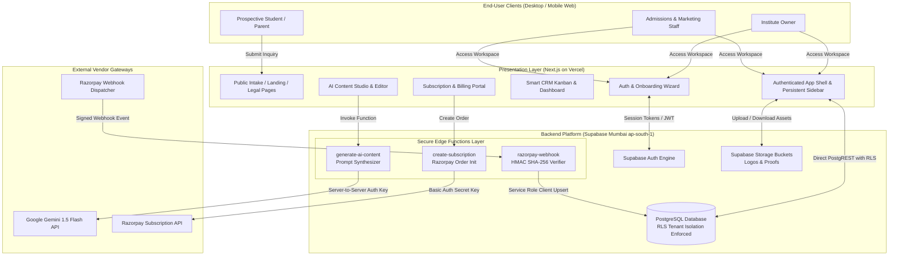
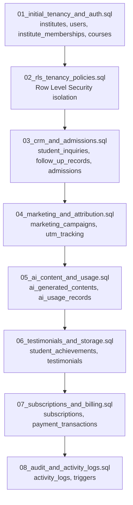

# Master Execution Plan: AI-Powered Coaching Academy Growth & Admissions Platform

**Document Identifier:** `MASTER_EXECUTION_PLAN.md`  
**Version:** 1.0.0 (Consolidated Master Plan)  
**Status:** Implementation-Ready Planning Baseline (Awaiting Milestone Phase 1 Authorization)  
**Roles & Authorities:** Senior Technical Project Manager, Software Architect, Product Manager, Engineering Lead  
**Target Architecture:** Next.js (React Server Components), TypeScript, Tailwind CSS, Supabase (PostgreSQL, Auth, Storage, Edge Functions), External AI Provider (Google Gemini / OpenAI), Razorpay Subscriptions  

---

## Executive Table of Contents
1. [Section 1: Project Overview](#section-1-project-overview)
2. [Section 2: Project Scope](#section-2-project-scope)
3. [Section 3: Technology Stack and Architecture](#section-3-technology-stack-and-architecture)
4. [Section 4: System Modules and Dependencies](#section-4-system-modules-and-dependencies)
5. [Section 5: User Roles and Permissions](#section-5-user-roles-and-permissions)
6. [Section 6: Detailed Development Roadmap](#section-6-detailed-development-roadmap)
7. [Section 7: Task-Level Implementation Breakdown](#section-7-task-level-implementation-breakdown)
8. [Section 8: Database Implementation Plan](#section-8-database-implementation-plan)
9. [Section 9: API and Integration Implementation Plan](#section-9-api-and-integration-implementation-plan)
10. [Section 10: UI/UX Implementation Plan](#section-10-uiux-implementation-plan)
11. [Section 11: Security and Quality Gates](#section-11-security-and-quality-gates)
12. [Section 12: Testing Strategy](#section-12-testing-strategy)
13. [Section 13: Open Decisions and Blocking Dependencies](#section-13-open-decisions-and-blocking-dependencies)
14. [Section 14: Risk Register](#section-14-risk-register)
15. [Section 15: Final Implementation Sequence](#section-15-final-implementation-sequence)

---

# Section 1: Project Overview

### 1.1 Project Vision
To become the premier business growth and operational operating system for test-preparation academies and coaching institutes. The platform transforms fragmented, manual promotional efforts and leaky admissions processes into a unified, AI-accelerated student acquisition engine that connects syllabus material to marketing, marketing to prospective inquiries, inquiries to confirmed admissions, and student achievements to authentic social proof.

### 1.2 Problem Being Solved
Test-preparation coaching academies (JEE, NEET, CET, UPSC, Banking, Foundation) operate in highly competitive, regional markets with strict, recurring batch cycles. They suffer from seven acute operational bottlenecks:
1. **Content Creation Friction:** Teachers and administrators spend 10–15 hours weekly drafting social media posts, exam breakdowns, reels scripts, and WhatsApp announcements.
2. **Inquiry Leakage & Chaos:** Prospective student leads arrive across unlinked channels (walk-ins, phone calls, website forms, WhatsApp chats, social DMs) without centralized capture.
3. **Inconsistent Counsellor Follow-Ups:** Inquiries go cold due to forgotten callbacks, lack of structured pipelines, and missing activity logs.
4. **Opaque Marketing ROI:** Founders spend heavily on Meta ads, hoardings, and school seminars without knowing which channel yields confirmed student fee payments.
5. **Underutilized Social Proof:** Past student ranks, percentiles, and parent testimonials remain trapped in physical registers or lost in photo galleries instead of driving promotional campaigns.
6. **Repetitive Manual Outreach:** Staff manually send repetitive demo reminders, schedule updates, and fee notices.
7. **Disjointed Business Visibility:** Academy directors lack a single real-time dashboard displaying inquiry velocity, conversion rates, and Cost Per Admission (CPA).

### 1.3 Proposed Solution
A multi-tenant B2B SaaS web platform engineered with Next.js and Supabase providing:
- An **AI Marketing & Content Studio** to generate exam-tailored social copy, reel scripts, WhatsApp broadcasts, and syllabus repurposing in seconds.
- A **Smart Admission CRM** with an 8-stage drag-and-drop Kanban pipeline (`New Inquiry` $\rightarrow$ `Contacted` $\rightarrow$ `Interested` $\rightarrow$ `Demo Scheduled` $\rightarrow$ `Demo Completed` $\rightarrow$ `Admission Pending` $\rightarrow$ `Admission Confirmed` $\rightarrow$ `Not Interested`).
- **Marketing Analytics & Spend Attribution** computing real-time Cost Per Inquiry (CPI) and Cost Per Admission (CPA).
- A **Student Success & Testimonial Vault** governing parental consent, rank proofs, and AI-assisted victory announcements.
- An **AI Growth Assistant** acting as an on-demand virtual business analyst answering operational inquiries grounded in real database metrics.
- Seamless **Razorpay Subscription Billing** supporting automated SaaS recurring revenue.

### 1.4 Target Customers and User Personas
- **Primary Paying Customer:** Coaching institutes, test-prep academies, and tutoring centres operating recurring batches.
- **Direct Workspace Users:**
  1. *Institute Owner / Director ("Director Rajan"):* Cares about batch occupancy, revenue run-rate, CAC, and CPA.
  2. *Centre Manager / Administrator ("Pooja Sharma"):* Cares about smooth intake, staff task allocation, and record integrity.
  3. *Admission Counsellor ("Amit Verma"):* Cares about daily callback agendas, WhatsApp communication, and hitting monthly enrollment quotas.
  4. *Marketing Specialist ("Kavita Nair"):* Cares about rapid content production, ad tracking links, and lead generation.
  5. *Senior Faculty ("Prof. Kulkarni"):* Cares about turning lecture highlights into study tips and celebrating student ranks.
- **Indirect Beneficiaries:**
  - *Prospective Students & Parents:* Receive instant inquiry acknowledgment, clear demo class schedules, and access to verified authentic rank testimonials.

### 1.5 Business Objectives
- $4\times$ acceleration in marketing content production throughput.
- Cut lead response time from $>24$ hours to $<15$ minutes.
- Increase lead-to-admission conversion rates by $25\%\text{--}35\%$ via systematic follow-up cadences.
- Provide $100\%$ mathematical attribution of marketing spend down to Cost Per Admission (CPA).

### 1.6 Core Product Modules
1. User Authentication & Institute Onboarding
2. Centralized Institute Dashboard
3. AI Marketing & Content Studio
4. Smart Admission CRM
5. Marketing Analytics & Campaign Tracking
6. Student Success & Testimonial Management
7. Communication & Follow-up Automation
8. AI Growth Assistant
9. Subscription & Billing Management
10. Student Performance Insights (Future Scope)

---

# Section 2: Project Scope

The product scope is partitioned into four clear operational horizons to prevent feature creep and protect MVP delivery velocity.

```
+---------------------------------------------------------------------------------------+
| HORIZON 1: MINIMUM VIABLE PRODUCT (MVP) - CORE REVENUE & ADMISSION ENGINE            |
+---------------------------------------------------------------------------------------+
| [x] Self-service Email/Password Auth with email verification via Supabase Auth         |
| [x] Multi-tenant workspace provisioning with strict PostgreSQL Row Level Security     |
| [x] Institute Onboarding Wizard (Profile, Exam Categories, Logo upload)                |
| [x] Centralized Institute Dashboard (Core Inquiries, Admissions, Conversion %, CPA)    |
| [x] Smart Admission CRM with 8-stage Kanban board and tabular search                   |
| [x] Public Student Inquiry Capture Form (/inquire/[slug])                             |
| [x] Counsellor Follow-up Drawer with agenda scheduler and call notes                   |
| [x] Admission closing modal with roll number and collected fee logging                |
| [x] AI Content Studio (Text-only: Reels, Instagram copy, WhatsApp, Syllabus repurpose) |
| [x] Marketing Campaign Registry, spend tracking, UTM links, and CPI/CPA computation   |
| [x] Student Success Vault (Ranks, Marksheets, Parental Consent, AI victory drafts)    |
| [x] One-Click Client-Side WhatsApp Intent Dispatch (wa.me pre-filled dynamic links)   |
| [x] Razorpay Subscription Checkout & verified HMAC SHA-256 Webhook synchronization     |
| [x] Mandatory Legal Pages (Privacy Policy, Terms, Refund Policy, Contact Us, Pricing)  |
+---------------------------------------------------------------------------------------+

+---------------------------------------------------------------------------------------+
| HORIZON 2: PHASE TWO - EXPANSION & ADVANCED AUTOMATION                                |
+---------------------------------------------------------------------------------------+
| [ ] Official Meta WhatsApp Business Cloud API Integration (Automated broadcasts)       |
| [ ] Automated Inbound Lead Ingestion from Meta Ads / Google Ads Webhooks              |
| [ ] AI Growth Assistant (Conversational querying of grounded institute metrics)       |
| [ ] Transactional Email Automation via Resend (Overdue alerts, parent receipts)        |
| [ ] AI Image / Promotional Banner Graphic Generation (Imagen / DALL-E)                |
| [ ] Granular Custom Role & Sub-Permission Builder                                     |
+---------------------------------------------------------------------------------------+

+---------------------------------------------------------------------------------------+
| HORIZON 3: FUTURE ENHANCEMENTS - SCALE & PERFORMANCE                                  |
+---------------------------------------------------------------------------------------+
| [ ] Student Academic Performance Insights (Internal test scores, subject report cards) |
| [ ] Multi-Branch Institute Chain Management (Parent org with branch sub-tenants)      |
| [ ] Direct Social Media Auto-Publishing (Meta Graph API / Instagram / Facebook Pages)  |
| [ ] Speech-to-Text Lecture Audio Transcription Engine (Whisper)                       |
| [ ] Predictive Batch Enrollment & Revenue Forecasting                                 |
+---------------------------------------------------------------------------------------+

+---------------------------------------------------------------------------------------+
| EXPLICITLY OUT OF SCOPE (NON-GOALS)                                                   |
+---------------------------------------------------------------------------------------+
| [!] Full Learning Management System (LMS) with student homework portals                |
| [!] Live online video classroom and video conferencing infrastructure                  |
| [!] Daily student attendance biometric tracking hardware integration                  |
| [!] Comprehensive fee accounting, double-entry bookkeeping, and staff payroll          |
| [!] Native mobile applications (iOS/Android) — Full responsive web used instead       |
+---------------------------------------------------------------------------------------+
```

---

# Section 3: Technology Stack and Architecture

### 3.1 Approved Technology Stack

| Layer | Approved Technology | Responsibility in System | Status |
|---|---|---|---|
| **Web Presentation** | Next.js 14+ (App Router, React 18/19, TypeScript) | Server Components for fast SEO intake pages; Client Components for interactive CRM Kanban and AI studio. | **Approved** |
| **Styling & Design Tokens** | Tailwind CSS + Lucide Icons + Shadcn UI | Implementation of `UI.md` tokens (Deep teal `#0B4F49`, warm neutral `#F7F8F6`, 4px spacing). | **Approved** |
| **Authentication** | Supabase Auth | Identity, password hashing, JWT issuance, email verification, session refresh. | **Approved** |
| **Relational Database** | Supabase PostgreSQL 15+ | Multi-tenant schema, foreign keys, indexes, Row Level Security (RLS) enforcement. | **Approved** |
| **Asset Storage** | Supabase Storage (S3-compatible) | Public bucket for logos; private authenticated bucket for mark sheets and testimonials. | **Approved** |
| **Serverless Compute** | Supabase Edge Functions (Deno / TS) | Untrusted boundary isolation: AI API proxying, Razorpay checkout, and webhook HMAC verification. | **Approved** |
| **AI Generation Engine** | External AI Provider API | Provider-agnostic adapter defaulting to **Google Gemini 1.5 Flash** (swappable to OpenAI GPT-4o-mini). | **Approved Baseline** |
| **Payment Gateway** | Razorpay Subscriptions & Orders | Recurring subscription billing, UPI Autopay, card checkout, invoices. | **Approved** |
| **Payment Webhooks** | Razorpay Webhooks | Server-to-server asynchronous synchronization of subscription states. | **Approved** |
| **Hosting & Cloud Edge** | Vercel + Supabase Cloud (Mumbai `ap-south-1`) | Next.js edge runtime with low-latency access to Indian coaching academies. | **Approved** |

### 3.2 High-Level System Architecture Diagram



---

# Section 4: System Modules and Dependencies

### Module 1: User Authentication & Institute Onboarding
- **Purpose:** Establish verified user identity, self-service institute workspace registration, and invite-based staff onboarding.
- **Features:** Email/password registration, mandatory email verification, multi-step institute setup wizard (legal name, vanity slug, exam categories, logo upload), invite link generator for staff with role binding.
- **Roles:** Unauthenticated (Sign up/Login), All authenticated (Profile), Owner/Admin (Invite staff).
- **Frontend Requirements:** Split-screen layout (Brilliant reference), password strength meter, guided progress indicator, responsive stacking on mobile.
- **Backend Requirements:** Supabase Auth triggers, atomic stored procedure creating `institutes` and `institute_memberships` (role: `OWNER`).
- **Database Dependencies:** `institutes`, `users`, `institute_memberships`.
- **Security:** RLS enabled; non-owners cannot mutate institute profiles; invitations restricted to designated email.
- **Acceptance Criteria:** A new user can register, verify email, create an institute, and enter the dashboard in $<2$ minutes.

### Module 2: Centralized Institute Dashboard
- **Purpose:** Provide high-altitude operational visibility, surfacing critical real-time KPIs, pending follow-ups, inquiry velocity, and recent activity.
- **Features:** KPI summary cards (Total Inquiries, Confirmed Admissions, Conversion Rate, Cost Per Admission), "Requires Immediate Action" alert drawer (overdue follow-ups, unassigned leads), 30-day velocity line charts, quick-action shortcuts.
- **Roles:** Owner (Full metrics + Financials), Admin (Operational KPIs), Counsellor (Assigned leads only), Marketer (Campaign KPIs only).
- **Frontend Requirements:** Spacious layout, Manrope headers, tabular numerals for KPIs, skeleton loaders during fetch, responsive wrapping on mobile.
- **Backend Requirements:** SQL aggregation functions calculating metrics filtered by `institute_id` and tenant timezone (`Asia/Kolkata`).
- **Database Dependencies:** `student_inquiries`, `admissions`, `marketing_campaigns`.
- **Security:** Financial data (CPA, revenue) redacted for Counsellors and Faculty.
- **Acceptance Criteria:** Initial paint $<1.2\text{s}$; KPI cards accurately reflect underlying table mutations upon cache revalidation.

### Module 3: AI Marketing & Content Studio
- **Purpose:** Empower non-technical coaching staff to draft high-converting social media copy, video scripts, and marketing calendars in seconds.
- **Features:** Exam-specific Prompt Studio (JEE, NEET, CET, UPSC); Reel/Shorts scripts with visual/audio storyboards; WhatsApp promotional broadcasts; Syllabus Repurposing Engine (transforms lecture notes into 5 micro-assets); in-app markdown editor; Content Vault with tagging.
- **Roles:** Owner, Admin, Marketing Manager, Faculty (Drafting).
- **Frontend Requirements:** 2-column studio (Prompt controls on left, interactive editor on right), character counters, one-click copy with WhatsApp markdown bolding.
- **Backend Requirements:** Supabase Edge Function `generate-ai-content` proxying Gemini 1.5 Flash; server-side token quota metering.
- **Database Dependencies:** `ai_generated_contents`, `ai_usage_records`, `subscriptions`.
- **Security:** System prompt guardrails prohibiting false ranks or unverified claims; plan token caps enforced prior to calling external API.
- **Acceptance Criteria:** Streaming copy returns within 2.5 seconds; exhausted plan quotas trigger an upgrade modal with HTTP 402.

### Module 4: Smart Admission CRM
- **Purpose:** Centralized inquiry pipeline preventing lead leakage, driving systematic counsellor follow-ups, and recording admissions.
- **Features:** Public intake web form (`/inquire/[slug]`); manual walk-in lead entry modal; 8-stage drag-and-drop Kanban pipeline; filtered tabular lead list with search; counsellor assignment; follow-up scheduler with agenda alerts; admission closing modal capturing fees and roll number.
- **Roles:** Owner, Admin, Admission Counsellor.
- **Frontend Requirements:** Accessible Kanban board with drag-and-drop; touch-friendly lead cards on mobile; lead detail drawer; mandatory lost reason modal.
- **Backend Requirements:** PostgREST endpoints with optimistic UI updates; database check constraints on stage transitions.
- **Database Dependencies:** `student_inquiries`, `follow_up_records`, `admissions`, `courses`.
- **Security:** Counsellors can be restricted to assigned leads via RLS; phone numbers masked for non-authorized viewers.
- **Acceptance Criteria:** Lead stage updates persist in $<300\text{ms}$; moving to `NOT_INTERESTED` requires a structured lost reason.

### Module 5: Marketing Analytics & Campaign Tracking
- **Purpose:** Attribute prospective inquiries and student admissions back to specific campaigns, calculating true marketing ROI and CAC.
- **Features:** Campaign registry (Meta, Google, Print, Hoardings, Seminars); marketing spend logs; UTM tag link generator; automated Cost Per Inquiry (CPI) and Cost Per Admission (CPA) calculation; comparative channel performance bar charts.
- **Roles:** Owner (Full access), Admin (Full access), Marketing Manager.
- **Frontend Requirements:** Interactive charts matching `UI.md` palette (Teal `#0B6B60`, Blue `#4B83C4`, Amber `#D69A36`); date range picker.
- **Backend Requirements:** Aggregate queries dividing spend by attributed leads and confirmed enrollments.
- **Database Dependencies:** `marketing_campaigns`, `student_inquiries`, `admissions`.
- **Security:** Zero divide protection (`N/A` if spend or inquiries are 0); spend data restricted to Owner/Admin/Marketer.
- **Acceptance Criteria:** Logging a ₹15,000 spend against a campaign with 10 admissions dynamically renders an exact CPA of ₹1,500.

### Module 6: Student Success & Testimonial Management
- **Purpose:** Systematize the collection, parental consent verification, and promotional weaponization of student ranks and alumni reviews.
- **Features:** Achievement repository (Exam, AIR, marks, percentile); marksheet proof and photo upload to Supabase Storage; parental consent verification checklist; AI-assisted victory announcement copy generator; approval governance workflow (`DRAFT` $\rightarrow$ `APPROVED`).
- **Roles:** Owner, Admin, Marketing Manager, Faculty (Submission).
- **Frontend Requirements:** Visual grid of student cards, proof preview modal, consent badge status indicator.
- **Backend Requirements:** Authenticated signed URL generator for private proof documents; storage bucket security policies.
- **Database Dependencies:** `student_achievements`, `testimonials`.
- **Security:** AI announcement generation is blocked until `consent_verified = true`; unapproved testimonials cannot be queried by public APIs.
- **Acceptance Criteria:** Uploaded proof files are accessible only to authenticated institute staff; public endpoint exposes only approved records.

### Module 7: Communication & Follow-up Automation
- **Purpose:** Standardize outreach messaging and eliminate missed student callbacks.
- **Features:** Dynamic message template manager (`{{student_name}}`, `{{course_name}}`); client-side one-click WhatsApp intent launcher (`wa.me`); communication audit trail logging call outcomes and timestamps.
- **Roles:** Owner, Admin, Counsellor.
- **Frontend Requirements:** Template selection drop-down, dynamic variable preview, prominent "Open WhatsApp" action button ($\ge 44\text{px}$ touch target).
- **Backend Requirements:** Client URL encoding utility; insertion into `follow_up_records`.
- **Database Dependencies:** `follow_up_records`, `student_inquiries`.
- **Security:** All manual outreach attempts require counsellor notes before resolving a follow-up task.
- **Acceptance Criteria:** Clicking WhatsApp button formats message parameters cleanly and opens WhatsApp Web/mobile instantly.

### Module 8: AI Growth Assistant (Phase 2 / Horizon 2)
- **Purpose:** Virtual business analyst answering strategic questions grounded in the institute's real operational metrics.
- **Features:** Conversational chat interface; natural language query engine; operational metric synthesis (lead velocity, conversion per counsellor, channel ROI).
- **Roles:** Institute Owner, Institute Admin.
- **Backend Requirements:** Edge Function `growth-assistant` querying sanitized aggregates; strict PII stripping before LLM invocation.
- **Database Dependencies:** Aggregate views over `student_inquiries`, `admissions`, `marketing_campaigns`.
- **Security:** Role guard: 403 Forbidden for Counsellor and Faculty roles.
- **Acceptance Criteria:** Accurately answers "What was our CPA for NEET last month?" matching the Analytics dashboard metrics.

### Module 9: Subscription & Billing Management
- **Purpose:** Manage commercial SaaS monetization, plan quotas, checkout, and webhook lifecycle.
- **Features:** Tier selection (Starter ₹499/mo, Growth ₹1,499/mo, Pro ₹2,999/mo); client Razorpay checkout modal; Edge Function webhook handler; plan quota enforcement; 7-day payment failure grace period; tax invoice downloads; legal pages (Privacy, Terms, Refunds, Contact).
- **Roles:** Institute Owner only.
- **Frontend Requirements:** Split-panel checkout interface (Teal inspiration panel), persistent billing status badge, past invoice table.
- **Backend Requirements:** Razorpay API integration; HMAC SHA-256 signature verification in Edge Function.
- **Database Dependencies:** `subscriptions`, `payment_transactions`.
- **Security:** Razorpay keys kept strictly server-side; webhook replay attack protection via unique `razorpay_payment_id` checks.
- **Acceptance Criteria:** Verified webhook updates subscription status to `ACTIVE` in $<500\text{ms}$; forged webhooks reject with 400.

### Module 10: Student Performance Insights (Phase 3 / Horizon 3)
- **Purpose:** Bridge classroom test series marks into marketing by tracking internal batch percentiles and standout achievers.
- **Features:** Mock test score entry, subject breakdowns, batch percentile distributions, student report card PDFs.
- **Roles:** Owner, Admin, Faculty.
- **Status:** **Explicitly Out of MVP Scope**; designed for architectural compatibility in Phase 3.

---

# Section 5: User Roles and Permissions

### 5.1 Role Definitions
1. **Platform Super Admin:** Platform owner/operator managing all institute tenants, platform-wide billing, system health, and global LLM configurations.
2. **Institute Owner:** The legal/commercial director of the coaching academy. Has supreme authority over billing, staff memberships, revenue reports, and institute settings.
3. **Institute Administrator:** Operations manager running the center. Manages courses, leads, counsellors, and campaigns, but cannot delete the institute or alter Razorpay bank billing details.
4. **Admission Counsellor:** Front-line sales and consultation staff. Manages assigned student leads, schedules demo classes, updates follow-up logs, and records conversions.
5. **Marketing Manager:** Growth specialist managing ad campaigns, creating AI copy, managing the testimonial vault, and monitoring lead acquisition metrics.
6. **Teacher / Faculty:** Academic instructor who submits educational notes for repurposing and logs student test scores and achievements.

### 5.2 Consolidated Role-Permission Matrix

| Resource / Action | Platform Super Admin | Institute Owner | Institute Admin | Admission Counsellor | Marketing Manager | Teacher / Faculty |
|---|:---:|:---:|:---:|:---:|:---:|:---:|
| **Institute Profile & Branding** | View/Manage All | Full Access | Full Access | Read-Only | Read-Only | Read-Only |
| **User & Staff Management** | All Tenants | Invite/Manage All | Invite/Manage Non-Owners | None | None | None |
| **Subscription & Billing** | Platform Global | Full Access | None | None | None | None |
| **CRM: View All Institute Leads** | All Tenants | Full Access | Full Access | If Authorized | Read-Only | None |
| **CRM: View Assigned Leads Only** | N/A | N/A | N/A | Full Access | N/A | None |
| **CRM: Create / Edit Inquiries** | Full Access | Full Access | Full Access | Full Access | None | None |
| **CRM: Delete Inquiries** | Full Access | Full Access | None | None | None | None |
| **CRM: Log Follow-ups & Notes** | Full Access | Full Access | Full Access | Full Access | None | None |
| **CRM: Confirm Admission & Fees** | Full Access | Full Access | Full Access | Full Access | None | None |
| **CRM: Export Leads to CSV** | Full Access | Full Access | None | None | None | None |
| **AI Studio: Generate Marketing Copy**| Global Control | Full Access | Full Access | None | Full Access | Drafts Only |
| **AI Studio: Edit & Save to Vault** | Full Access | Full Access | Full Access | None | Full Access | Full Access |
| **Analytics: View Financial CPA/ROI** | All Tenants | Full Access | Full Access | None | Full Access | None |
| **Campaigns: Create & Log Spend** | Full Access | Full Access | Full Access | None | Full Access | None |
| **Testimonials: Submit Achievements** | Full Access | Full Access | Full Access | None | Full Access | Full Access |
| **Testimonials: Upload Consent Proof**| Full Access | Full Access | Full Access | None | Full Access | None |
| **Testimonials: Approve Publication** | Full Access | Full Access | Full Access | None | None | None |
| **AI Growth Assistant** | Full Access | Full Access | Full Access | None | None | None |

---

# Section 6: Detailed Development Roadmap

```mermaid
gantt
    title Complete Development Roadmap (Phases 0 through 8)
    dateFormat  YYYY-MM-DD
    section Setup & Foundation
    Phase 0: Requirements & Open Decisions Lock :done, p0, 2026-11-10, 3d
    Phase 1: Foundation, Multi-Tenancy & Auth   :active, p1, after p0, 10d
    section Core Operational Modules
    Phase 2: Dashboard & Admissions CRM         :p2, after p1, 14d
    Phase 3: AI Marketing & Content Studio      :p3, after p2, 10d
    Phase 4: Marketing Analytics & Campaigns    :p4, after p3, 8d
    section Trust & Monetization
    Phase 5: Student Success & Testimonials     :p5, after p4, 8d
    Phase 6: Razorpay Billing & Webhooks        :p6, after p5, 10d
    section Advanced & Hardening
    Phase 7: AI Growth Assistant (Phase 2)      :p7, after p6, 8d
    Phase 8: Hardening, E2E Testing & Launch    :p8, after p7, 10d
```

---

### Phase 0: Requirement Finalization and Project Setup
- **Objective:** Establish unambiguous architecture baseline, lock open decisions, configure development environment, and prepare secrets strategy.
- **Features Included:** Repository linting/formatting rules, TypeScript configurations, environment secret conventions.
- **Tasks:** Review open decisions, configure `.env.example`, establish Git branching standards.
- **Deliverables:** Approved `MASTER_EXECUTION_PLAN.md`, repository development environment ready.
- **Dependencies:** None.
- **Definition of Done:** Project Owner confirms planning baseline and authorizes Phase 1 commencement.

---

### Phase 1: Foundation and Multi-Tenancy
- **Objective:** Bootstrap Next.js App Router application, configure Supabase client/server SSR utilities, deploy database schema with strict RLS multi-tenancy, and implement authentication and institute onboarding.
- **Features Included:**
  - Next.js 14+ scaffold with Tailwind CSS, Lucide Icons, and `UI.md` design tokens.
  - Supabase Auth integration (Email/Password, verification emails).
  - PostgreSQL schema: `institutes`, `users`, `institute_memberships`, `courses`.
  - Multi-tenant Row Level Security (RLS) policies.
  - Institute Onboarding Wizard & Staff Invitation modal.
  - Authenticated Application Shell with persistent responsive sidebar.
- **Deliverables:** Working authentication, verified RLS test suite, onboarding wizard, application shell.
- **Database Changes:** Baseline SQL migration for core tables and RLS policies.
- **UI Screens:** `/login`, `/signup`, `/verify-email`, `/onboarding`, `/settings/team`.
- **Security Considerations:** Cross-tenant URL tampering must return `403 Forbidden` via database RLS.
- **Testing Requirements:** Vitest unit tests for auth helpers; Supabase RLS integration tests confirming isolation.
- **Definition of Done:** A new user can register, verify email, create an institute, invite a counsellor, and have complete tenant data isolation verified via automated tests.

---

### Phase 2: Dashboard and Admissions CRM
- **Objective:** Deliver the operational core of the platform: centralized dashboard metrics and the end-to-end inquiry CRM pipeline.
- **Features Included:**
  - Public Student Inquiry Form (`/inquire/[slug]`).
  - Centralized Executive Dashboard with KPI cards and action alerts.
  - Drag-and-drop Kanban pipeline with 8 status stages.
  - Searchable tabular lead list with multi-column filters.
  - Follow-up Scheduler Drawer and communication call notes.
  - Admission Confirmation modal capturing roll number and collected fees.
- **Deliverables:** Operational Admissions CRM, Public intake endpoint, Executive Dashboard.
- **Database Changes:** Migration for `student_inquiries`, `follow_up_records`, `admissions`.
- **UI Screens:** `/dashboard`, `/admissions/crm`, `/admissions/inquiries`, `/inquire/[slug]`.
- **Security Considerations:** Rate-limit public inquiry submissions; sanitize student input data; restrict financial KPIs to Owner/Admin.
- **Testing Requirements:** Drag-and-drop state persistence tests; mandatory lost reason validation tests.
- **Definition of Done:** 100 sample leads can be ingested via public form, assigned to counsellors, transitioned across all stages, and converted to admissions with zero errors.

---

### Phase 3: AI Marketing and Content Studio
- **Objective:** Implement generative AI marketing tools to accelerate promotional copy creation for coaching staff.
- **Features Included:**
  - Supabase Edge Function `generate-ai-content` proxying Google Gemini 1.5 Flash.
  - Prompt Studio for Reels/Shorts scripts, Instagram posts, and WhatsApp broadcasts.
  - Syllabus Repurposing Engine (lecture notes $\rightarrow$ 5 micro-assets).
  - Interactive markdown editor with copy-to-clipboard and WhatsApp formatting.
  - Content Vault repository with tagging and search.
  - Plan token quota metering.
- **Deliverables:** Operable AI Content Studio, Edge Function proxy, Content Vault.
- **Database Changes:** Migration for `ai_generated_contents`, `ai_usage_records`.
- **UI Screens:** `/marketing/ai-studio`, `/marketing/content-vault`.
- **Security Considerations:** API secrets kept strictly in Edge Function environment; system prompt guardrails against false rank claims.
- **Testing Requirements:** Mock AI provider tests; token quota exhaustion HTTP 402 tests.
- **Definition of Done:** User selects an exam, inputs notes, receives formatted copy within $<3$ seconds, edits and saves cleanly to the vault.

---

### Phase 4: Marketing Analytics & Campaign Tracking
- **Objective:** Connect marketing expenditure directly to student inquiries and confirmed admissions to calculate true CAC.
- **Features Included:**
  - Campaign Registry (Meta, Google, Print, Hoardings, Seminars).
  - Spend logging and UTM link generator.
  - Lead attribution engine (attaching `campaign_id` to inquiries).
  - Calculation engine for Cost Per Inquiry (CPI) and Cost Per Admission (CPA).
  - Comparative channel performance visual charts.
- **Deliverables:** Marketing Analytics Dashboard with automated financial attribution.
- **Database Changes:** Migration for `marketing_campaigns`.
- **UI Screens:** `/marketing/campaigns`, `/insights/analytics`.
- **Security Considerations:** Zero-divide protection for new campaigns; financial metrics hidden from Counsellor/Faculty.
- **Testing Requirements:** Mathematical accuracy unit tests for CPI, CPA, and ROAS calculations.
- **Definition of Done:** Logging spend against an attributed campaign dynamically calculates exact CPI and CPA matching manual arithmetic.

---

### Phase 5: Student Success and Testimonials
- **Objective:** Systematize the collection, parental consent verification, and promotional weaponization of student achievements.
- **Features Included:**
  - Student achievement repository (Exam, AIR, marks, percentile).
  - Private Supabase Storage bucket for mark sheets and student photos.
  - Parental consent verification checklist and document uploader.
  - AI-assisted victory announcement copy generator.
  - Approval governance workflow (`DRAFT` $\rightarrow$ `APPROVED`).
- **Deliverables:** Secure Student Success Vault, AI victory story generator.
- **Database Changes:** Migration for `student_achievements`, `testimonials`.
- **UI Screens:** `/insights/testimonials`, `/insights/testimonials/new`.
- **Security Considerations:** Signed URLs for private proof documents; block AI promotional generation until parental consent is verified.
- **Testing Requirements:** Storage policy verification; consent enforcement tests.
- **Definition of Done:** Mark sheets upload securely to private storage; achievements without verified consent cannot trigger AI copy generation.

---

### Phase 6: Subscription, Billing & Webhook Infrastructure
- **Objective:** Implement commercial monetization via Razorpay subscriptions, enforce plan entitlements, and process asynchronous billing events.
- **Features Included:**
  - Subscription tier catalog (Starter ₹499/mo, Growth ₹1,499/mo, Pro ₹2,999/mo).
  - Edge Function `create-subscription` initiating Razorpay checkout.
  - Client-side Razorpay modal integration.
  - Edge Function `razorpay-webhook` with HMAC SHA-256 signature verification.
  - Plan quota enforcement guards across AI and CRM modules.
  - 7-day payment failure grace period and read-only lockout logic.
  - Required legal pages: Privacy Policy, Terms & Conditions, Refund Policy, Contact Us, Pricing Page.
- **Deliverables:** Complete SaaS billing gateway, verified webhook processor, published legal pages.
- **Database Changes:** Migration for `subscriptions`, `payment_transactions`.
- **UI Screens:** `/settings/billing`, `/pricing`, `/privacy`, `/terms`, `/refund-policy`, `/contact`.
- **Security Considerations:** Secret keys kept server-side; webhook idempotent replay protection.
- **Testing Requirements:** Webhook signature verification tests; subscription state transition tests.
- **Definition of Done:** Simulating `subscription.charged` unlocks plan access; forged webhook payloads reject with HTTP 400; legal pages linked in footer.

---

### Phase 7: AI Growth Assistant (Phase 2 Horizon)
- **Objective:** Virtual business analyst answering strategic questions grounded in real institute operational metrics.
- **Features Included:** Conversational chat interface, grounded metric synthesis (lead velocity, conversion rates, CPA by channel), PII stripping.
- **Deliverables:** Interactive AI Growth Assistant in Dashboard.
- **Database Changes:** Aggregate SQL reporting functions.
- **UI Screens:** `/dashboard/growth-assistant`.
- **Security Considerations:** Strict PII redaction (no student names or phone numbers sent to LLM); 403 Forbidden for non-owners.
- **Testing Requirements:** Accuracy tests comparing LLM answers to database aggregate figures.
- **Definition of Done:** Assistant answers questions regarding monthly inquiries and CPA with mathematical precision matching database records.

---

### Phase 8: Hardening, E2E Testing & Production Deployment
- **Objective:** Execute exhaustive security, authorization, multi-tenant isolation, load, and responsive testing prior to production launch.
- **Features Included:** Automated Playwright E2E suite, mobile responsiveness audit (per `responsiveness.md`), cross-tenant RLS penetration audit (per `security.md`), Vercel production deployment.
- **Deliverables:** Fully audited production platform deployed to custom domain with SSL.
- **Security Considerations:** Zero open vulnerabilities in Supabase RLS; no secrets exposed in client bundles.
- **Testing Requirements:** 100% pass on Playwright E2E journeys; Lighthouse mobile score $\ge 90$; all touch targets $\ge 44\text{px}$.
- **Definition of Done:** Platform passes all security quality gates and operates live on production infrastructure.

---

# Section 7: Task-Level Implementation Breakdown

```
EPIC HIERARCHY:
Epic -> Feature Area -> Development Task [Task ID] -> Priority -> Dependencies -> Deliverable -> Acceptance Criteria
```

### Epic 1: Foundation, Multi-Tenancy & Authentication (Phase 1)

| Task ID | Task Title | Description | Priority | Dependencies | Deliverable | Acceptance Criteria |
|---|---|---|:---:|---|---|---|
| `TSK-FND-001` | Next.js App Router Scaffold | Initialize Next.js 14+ with App Router, TypeScript, Tailwind CSS, Lucide Icons, and configure `UI.md` design tokens (`#0B4F49`, `#F7F8F6`). | **Critical** | None | Next.js repo scaffold | `pnpm build` completes with zero errors; token classes render correctly. [Completed] |
| `TSK-FND-002` | Supabase SSR Utilities | Configure Supabase browser client, server client, and middleware helpers using `@supabase/ssr`. | **Critical** | `TSK-FND-001` | Supabase context helpers (`lib/supabase/client.ts`, `server.ts`, `middleware.ts`, `middleware.ts`) | Middleware correctly reads and refreshes session tokens from cookies via official `@supabase/ssr` `getAll`/`setAll` pattern; `pnpm build` succeeds with 0 errors. [Completed] |
| `TSK-DB-001` | Core Database Schema & Hardening | Author PostgreSQL migration for `institutes`, `users`, `institute_memberships`, `institute_invitations`, `courses`, and `subscriptions` with foreign keys, branch self-reference (`parent_institute_id`), composite uniqueness, partial unique index for single active owner (`idx_single_active_owner_per_user`), invariant guard triggers, and hardened atomic RPCs (`create_institute_with_owner`, `accept_employee_invitation`, `update_my_profile`). | **Critical** | `TSK-FND-002` | SQL migration file (`supabase/migrations/20261110000001_phase1_initial_schema.sql`) | Tables instantiate cleanly with all constraints and indexes; RPCs and triggers pass security audit; TypeScript types validated in `types/database.ts`; awaiting user approval for remote execution. [Completed Locally & Hardened] |
| `TSK-DB-002` | Multi-Tenant RLS Policies & Hardening | Author and enable PostgreSQL Row Level Security (RLS) policies on all core tables with caller-scoped security definer helpers (`has_active_membership`, `get_my_institutes`, `get_my_role`), public inquiry RPCs (`get_public_institute_by_slug`, `get_public_courses`), safe fixed search_path, privilege escalation guards, and automated test suite (`supabase/tests/test_phase1_rls.sql`). | **Critical** | `TSK-DB-001` | RLS SQL migration (`supabase/migrations/20261110000002_phase1_rls_policies.sql`) | User from Institute A querying Institute B data receives 0 rows (`TC-SEC-01`); public table scraping prevented; suspended users have 0 access; client direct write to subscriptions prohibited; all 10 SQL test assertions pass; awaiting user approval for remote execution. [Completed Locally & Hardened] |
| `TSK-AUTH-001` | User Authentication UI & Actions | Build Split-Screen Sign Up, Login, and Password Reset screens conforming to Brilliant inspiration reference. | **High** | `TSK-DB-002` | Auth pages & Server Actions | Valid credentials issue session JWT; invalid credentials render clear error alerts. |
| `TSK-AUTH-002` | Institute Onboarding Wizard | Build multi-step onboarding wizard capturing institute legal name, slug, exam categories, and logo upload to Supabase Storage. | **High** | `TSK-AUTH-001` | Onboarding Wizard UI | Atomic transaction creates institute, assigns caller as `OWNER`, and activates 14-day trial. |
| `TSK-AUTH-003` | Employee Account Management | Build Employee Management console (`/settings/team`) allowing owners/admins to invite employees via email with role selection (Admin, Counsellor, Marketer, Faculty), generate 7-day secure tokens, and support employee credential registration and role activation. | **High** | `TSK-AUTH-002`, `TSK-UI-001` | Employee management UI & Invitation Flow | Employee accepts invite, sets up individual password, and logs in with role-enforced access. |
| `TSK-UI-001` | Authenticated Shell & Sidebar | Build persistent left sidebar (240px expanded / 72px collapsed) with mobile drawer navigation per `UI.md` and `responsiveness.md`. | **High** | `TSK-AUTH-001` | App layout shell | Sidebar renders role-permitted links; mobile hamburger menu toggles below 768px. |

---

### Epic 2: Dashboard & Admissions CRM (Phase 2)

| Task ID | Task Title | Description | Priority | Dependencies | Deliverable | Acceptance Criteria |
|---|---|---|:---:|---|---|---|
| `TSK-DSH-001` | Executive KPI Cards | Build Executive Metric Cards (Total Inquiries, Confirmed Admissions, Conversion Rate, CPA) with tabular numerals. | **High** | `TSK-AUTH-002` | Dashboard KPI component | Metrics aggregate dynamically from database; zero divide errors when leads are 0. |
| `TSK-DSH-002` | Immediate Action Drawer | Build alert drawer surfacing overdue counsellor follow-ups and unassigned incoming leads with direct navigation links. | **Medium** | `TSK-DSH-001` | Alert drawer UI | Overdue tasks trigger prominent visual badge and link to lead profile. |
| `TSK-CRM-001` | Public Student Inquiry Form | Build responsive public web intake page at `/inquire/[slug]` with input validation, CSRF protection, and rate limiting. | **Critical** | `TSK-DB-001` | Public inquiry web page | Valid submissions create `student_inquiries` record with `source = 'WEBSITE'`. |
| `TSK-CRM-002` | Manual Lead Creation Modal | Build in-app modal allowing staff to manually enter walk-ins and phone calls with source attribution and course selection. | **High** | `TSK-CRM-001` | In-app lead modal | Successfully inserts lead record and updates CRM Kanban board instantly. |
| `TSK-CRM-003` | 8-Stage CRM Kanban Board | Build drag-and-drop Kanban pipeline supporting 8 stages, card drag reordering, and optimistic UI updates. | **Critical** | `TSK-CRM-002` | Interactive Kanban board | Dragging card updates database status in $<300\text{ms}$; invalid drops revert cleanly. |
| `TSK-CRM-004` | Tabular Search & Filter View | Build searchable table view of leads supporting multi-attribute filters (exam, counsellor, date range, status). | **High** | `TSK-CRM-003` | Searchable CRM table | Search by phone number or name filters records in real-time with pagination. |
| `TSK-CRM-005` | Follow-up Scheduler & Logs | Build Follow-up Drawer allowing counsellors to set callback timestamps, select communication channel, and log call outcome notes. | **High** | `TSK-CRM-003` | Task scheduler drawer | Scheduled follow-up updates `next_followup_at`; logs history in activity timeline. |
| `TSK-CRM-006` | Admission Closing Dialog | Build deal-closing modal capturing enrolled course, student roll number, and collected fee amount upon marking confirmed. | **High** | `TSK-CRM-005` | Admission closing modal | Updates status to `ADMISSION_CONFIRMED`; inserts record into `admissions` table. |

---

### Epic 3: AI Marketing & Content Studio (Phase 3)

| Task ID | Task Title | Description | Priority | Dependencies | Deliverable | Acceptance Criteria |
|---|---|---|:---:|---|---|---|
| `TSK-AI-001` | AI Edge Function Proxy | Deploy Supabase Edge Function `generate-ai-content` proxying Google Gemini 1.5 Flash using secure server-side API keys. | **Critical** | `TSK-FND-002` | Deno Edge Function | Authenticates caller JWT, injects system guardrails, streams generated markdown. |
| `TSK-AI-002` | AI Quota Enforcement | Implement monthly token/generation quota tracking in `ai_usage_records` checking plan entitlements. | **High** | `TSK-AI-001` | Quota middleware | Requests exceeding plan limit return HTTP 402 with plan upgrade modal. |
| `TSK-AI-003` | Exam Prompt Studio UI | Build 2-column studio with templates for Reel scripts, Instagram posts, and WhatsApp promotional broadcasts. | **High** | `TSK-AI-002` | Prompt Studio interface | Selected options generate structured, exam-tailored marketing copy. |
| `TSK-AI-004` | Content Repurposing Engine | Build tool transforming raw lecture notes or formula lists into 5 distinct micro-content social assets. | **Medium** | `TSK-AI-003` | Repurposing interface | Raw input decomposes into Tip of the Day, Quiz, Motivation, Formula, Advice. |
| `TSK-AI-005` | Content Vault & Editor | Build interactive markdown editor with character counters, WhatsApp formatting export, and tagging repository. | **Medium** | `TSK-AI-003` | Content Vault library | Saved copy persists in `ai_generated_contents` with exam tags and searchability. |

---

### Epic 4: Marketing Analytics & Campaigns (Phase 4)

| Task ID | Task Title | Description | Priority | Dependencies | Deliverable | Acceptance Criteria |
|---|---|---|:---:|---|---|---|
| `TSK-MKT-001` | Campaign Registry & Spend Log | Build Campaign Management UI to register marketing campaigns (Meta, Print, Hoardings, Seminars) with budget and spend entries. | **High** | `TSK-DB-001` | Campaign dashboard | Staff can create campaigns and log ongoing marketing expenditures. |
| `TSK-MKT-002` | UTM Tracking Link Generator | Build UTM link generator modal appending `?utm_source` and `?utm_campaign` tracking parameters to public intake links. | **Medium** | `TSK-MKT-001` | Link generator modal | Public intake form automatically records `campaign_id` when loaded with UTM. |
| `TSK-MKT-003` | CPI & CPA Calculation Engine | Implement backend calculation service computing Cost Per Inquiry, Cost Per Admission, and Return on Ad Spend (ROAS). | **Critical** | `TSK-CRM-006`, `TSK-MKT-001` | Analytics computation engine | Mathematically checks: $\text{Spend} / \text{Inquiries}$ and $\text{Spend} / \text{Admissions}$. |
| `TSK-MKT-004` | Comparative Channel Charts | Build visual bar charts comparing acquisition costs across channels using `UI.md` visualization palette. | **Medium** | `TSK-MKT-003` | Visual analytics charts | Correctly renders multi-series comparison without visual overflow on mobile. |

---

### Epic 5: Student Success & Testimonials (Phase 5)

| Task ID | Task Title | Description | Priority | Dependencies | Deliverable | Acceptance Criteria |
|---|---|---|:---:|---|---|---|
| `TSK-TST-001` | Achievement Entry & Proof Upload | Build Achievement Form supporting rank, marks, percentile, and secure proof file upload to Supabase Storage. | **High** | `TSK-DB-001` | Achievement uploader | Stores mark sheet and photo in private bucket; records path in database. |
| `TSK-TST-002` | Parental Consent Verification | Build parental consent checklist and signed form uploader governance system. | **High** | `TSK-TST-001` | Consent tracking component | Record must have `consent_verified = true` before promotional publishing is enabled. |
| `TSK-TST-003` | AI Victory Story Generator | Build generator converting verified student rank records into press releases and congratulatory social posts. | **Medium** | `TSK-TST-002`, `TSK-AI-001` | Victory story generator | Transforms raw rank data into professional celebratory copy without hallucinating facts. |
| `TSK-TST-004` | Approval Governance UI | Build Testimonial Review UI allowing Owner/Admin to transition records from `DRAFT` to `APPROVED`. | **Medium** | `TSK-TST-003` | Review interface | Only Owner/Admin can approve; unapproved records hidden from public endpoints. |

---

### Epic 6: Subscription, Billing & Webhooks (Phase 6)

| Task ID | Task Title | Description | Priority | Dependencies | Deliverable | Acceptance Criteria |
|---|---|---|:---:|---|---|---|
| `TSK-BIL-001` | Razorpay Edge Function Init | Deploy Edge Function `create-subscription` initiating Razorpay checkout sessions using server credentials. | **Critical** | `TSK-AUTH-002` | Deno Edge Function | Generates valid Razorpay subscription ID for Starter, Growth, or Pro plans. |
| `TSK-BIL-002` | Razorpay Checkout Modal | Integrate client-side Razorpay modal in the Billing portal supporting UPI Autopay, cards, and net banking. | **High** | `TSK-BIL-001` | Checkout UI component | Checkout modal opens seamlessly across desktop and mobile; captures payment tokens. |
| `TSK-BIL-003` | Webhook Signature Verifier | Deploy Edge Function `razorpay-webhook` verifying HMAC SHA-256 signatures and synchronizing subscription state. | **Critical** | `TSK-BIL-001` | Webhook processor | Valid signatures update DB to `ACTIVE`; forged signatures reject with HTTP 400. |
| `TSK-BIL-004` | Payment Failure & Grace Period | Implement 7-day grace period logic upon `payment.failed` webhook, locking workspace to read-only mode if unpaid. | **High** | `TSK-BIL-003` | Lifecycle state machine | Persistent grace banner appears; write actions blocked upon expiration. |
| `TSK-BIL-005` | Required Legal Pages | Build Privacy Policy, Terms & Conditions, Refund Policy, Contact Us, and Pricing Page per `payment_gateway.md`. | **High** | `TSK-FND-001` | 5 Legal pages & Footer links | Pages render cleanly, state Indian jurisdiction, and are linked in the footer. |

---

### Epic 7: AI Growth Assistant (Phase 7 / Horizon 2)

| Task ID | Task Title | Description | Priority | Dependencies | Deliverable | Acceptance Criteria |
|---|---|---|:---:|---|---|---|
| `TSK-AST-001` | Grounded Growth Edge Function | Deploy Edge Function `growth-assistant` synthesizing aggregate institute metrics into factual LLM prompts. | **High** | `TSK-MKT-003`, `TSK-CRM-006` | Deno Edge Function | Strips all PII; grounds answers strictly in real database aggregates. |
| `TSK-AST-002` | Growth Assistant Chat UI | Build conversational chat drawer in the Dashboard streaming responses to owner queries. | **High** | `TSK-AST-001` | Chat interface | Streams answers to queries regarding monthly inquiries, conversion, and CPA. |

---

### Epic 8: Hardening, E2E Testing & Launch (Phase 8)

| Task ID | Task Title | Description | Priority | Dependencies | Deliverable | Acceptance Criteria |
|---|---|---|:---:|---|---|---|
| `TSK-SEC-001` | Multi-Tenant RLS Penetration Audit| Execute automated test scripts attempting cross-tenant reads and mutations across all tables per `security.md`. | **Critical** | All DB tasks | Security audit report | Zero cross-tenant data leakage detected under automated attacks (`TC-SEC-01`). |
| `TSK-TST-E2E` | Playwright E2E Test Suite | Implement Playwright test suite covering Sign Up, Public Inquiry, CRM Kanban progression, and Billing checkout. | **Critical** | All UI tasks | Playwright test suite | All core end-to-end user journeys pass at $100\%$ in headless CI environment. |
| `TSK-UI-RSP` | Mobile Responsiveness Audit | Execute full responsive audit per `responsiveness.md` verifying touch targets ($\ge 44\text{px}$) and font sizes ($\ge 16\text{px}$). | **High** | All UI tasks | Responsive audit log | Zero horizontal scrolling; hamburger menu operates cleanly on small screens. |
| `TSK-DEP-001` | Production Cloud Deployment | Deploy Next.js to Vercel and configure Supabase Cloud in Mumbai (`ap-south-1`) with production domain and SSL. | **Critical** | `TSK-SEC-001` | Live production platform | Production deployment passes build with zero warnings; DNS and SSL active. |

---

# Section 8: Database Implementation Plan

### 8.1 Migration Sequence & Entity Dependencies



### 8.2 Detailed Entity Definitions & Constraints

```sql
-- Migration 01: Core Tenancy, Users, Invitations & Auth
CREATE TABLE institutes (
    id UUID PRIMARY KEY DEFAULT gen_random_uuid(),
    parent_institute_id UUID REFERENCES institutes(id) ON DELETE CASCADE, -- Extensible multi-branch hierarchy (DEC-12)
    name TEXT NOT NULL,
    slug TEXT UNIQUE NOT NULL CHECK (slug ~ '^[a-z0-9]+(?:-[a-z0-9]+)*$' AND length(slug) BETWEEN 3 AND 48),
    phone TEXT NOT NULL,
    city TEXT NOT NULL,
    state TEXT NOT NULL,
    logo_url TEXT,
    created_at TIMESTAMPTZ DEFAULT now() NOT NULL,
    updated_at TIMESTAMPTZ DEFAULT now() NOT NULL
);

CREATE INDEX idx_institutes_slug ON institutes(slug);

CREATE TABLE users (
    id UUID PRIMARY KEY REFERENCES auth.users(id) ON DELETE CASCADE,
    email TEXT UNIQUE NOT NULL,
    full_name TEXT NOT NULL,
    phone TEXT,
    created_at TIMESTAMPTZ DEFAULT now() NOT NULL,
    updated_at TIMESTAMPTZ DEFAULT now() NOT NULL
);

-- Trigger: Automatically sync auth.users into public.users
CREATE OR REPLACE FUNCTION public.handle_new_user()
RETURNS TRIGGER AS $$
BEGIN
    INSERT INTO public.users (id, email, full_name)
    VALUES (
        NEW.id,
        NEW.email,
        COALESCE(NEW.raw_user_meta_data->>'full_name', split_part(NEW.email, '@', 1))
    )
    ON CONFLICT (id) DO UPDATE 
    SET email = EXCLUDED.email,
        full_name = COALESCE(EXCLUDED.full_name, public.users.full_name),
        updated_at = now();
    RETURN NEW;
END;
$$ LANGUAGE plpgsql SECURITY DEFINER;

CREATE TABLE institute_memberships (
    id UUID PRIMARY KEY DEFAULT gen_random_uuid(),
    institute_id UUID NOT NULL REFERENCES institutes(id) ON DELETE CASCADE,
    user_id UUID NOT NULL REFERENCES users(id) ON DELETE CASCADE,
    role TEXT NOT NULL CHECK (role IN ('OWNER', 'ADMIN', 'COUNSELLOR', 'MARKETER', 'FACULTY')),
    status TEXT NOT NULL DEFAULT 'ACTIVE' CHECK (status IN ('ACTIVE', 'INVITED', 'SUSPENDED')),
    is_default BOOLEAN DEFAULT true NOT NULL,
    created_at TIMESTAMPTZ DEFAULT now() NOT NULL,
    updated_at TIMESTAMPTZ DEFAULT now() NOT NULL,
    UNIQUE (institute_id, user_id) -- Future-proof composite uniqueness (DEC-02)
);

CREATE INDEX idx_memberships_institute ON institute_memberships(institute_id);
CREATE INDEX idx_memberships_user ON institute_memberships(user_id);

-- Employee Invitations Management Table
CREATE TABLE institute_invitations (
    id UUID PRIMARY KEY DEFAULT gen_random_uuid(),
    institute_id UUID NOT NULL REFERENCES institutes(id) ON DELETE CASCADE,
    invited_by UUID NOT NULL REFERENCES users(id) ON DELETE CASCADE,
    email TEXT NOT NULL,
    role TEXT NOT NULL CHECK (role IN ('ADMIN', 'COUNSELLOR', 'MARKETER', 'FACULTY')),
    token TEXT UNIQUE NOT NULL,
    status TEXT NOT NULL DEFAULT 'PENDING' CHECK (status IN ('PENDING', 'ACCEPTED', 'EXPIRED', 'REVOKED')),
    expires_at TIMESTAMPTZ NOT NULL DEFAULT (now() + INTERVAL '7 days'),
    created_at TIMESTAMPTZ DEFAULT now() NOT NULL
);

CREATE INDEX idx_invitations_token ON institute_invitations(token);
CREATE INDEX idx_invitations_email ON institute_invitations(email);

CREATE TABLE courses (
    id UUID PRIMARY KEY DEFAULT gen_random_uuid(),
    institute_id UUID NOT NULL REFERENCES institutes(id) ON DELETE CASCADE,
    name TEXT NOT NULL,
    exam_category TEXT NOT NULL CHECK (exam_category IN ('JEE', 'NEET', 'MHT_CET', 'UPSC', 'FOUNDATION', 'OTHER')),
    base_fee NUMERIC(10,2) NOT NULL DEFAULT 0.00,
    is_active BOOLEAN DEFAULT true NOT NULL,
    created_at TIMESTAMPTZ DEFAULT now() NOT NULL
);

-- Migration 03: CRM & Admissions
CREATE TABLE student_inquiries (
    id UUID PRIMARY KEY DEFAULT gen_random_uuid(),
    institute_id UUID NOT NULL REFERENCES institutes(id) ON DELETE CASCADE,
    course_id UUID REFERENCES courses(id) ON DELETE SET NULL,
    campaign_id UUID, -- Foreign key added in Migration 04
    assigned_counsellor_id UUID REFERENCES users(id) ON DELETE SET NULL,
    student_name TEXT NOT NULL,
    phone TEXT NOT NULL,
    parent_phone TEXT,
    current_grade TEXT,
    status TEXT NOT NULL DEFAULT 'NEW_INQUIRY' CHECK (status IN (
        'NEW_INQUIRY', 'CONTACTED', 'INTERESTED', 'DEMO_SCHEDULED',
        'DEMO_COMPLETED', 'ADMISSION_PENDING', 'ADMISSION_CONFIRMED', 'NOT_INTERESTED'
    )),
    lost_reason TEXT CHECK (lost_reason IS NULL OR lost_reason IN (
        'FEE_HIGH', 'LOCATION_FAR', 'CHOSE_COMPETITOR', 'TIMING_CONFLICT', 'OTHER'
    )),
    next_followup_at TIMESTAMPTZ,
    last_contacted_at TIMESTAMPTZ,
    created_at TIMESTAMPTZ DEFAULT now() NOT NULL
);

CREATE TABLE follow_up_records (
    id UUID PRIMARY KEY DEFAULT gen_random_uuid(),
    inquiry_id UUID NOT NULL REFERENCES student_inquiries(id) ON DELETE CASCADE,
    counsellor_id UUID NOT NULL REFERENCES users(id) ON DELETE CASCADE,
    channel TEXT NOT NULL CHECK (channel IN ('CALL', 'WHATSAPP', 'IN_PERSON', 'EMAIL')),
    outcome_notes TEXT NOT NULL,
    scheduled_at TIMESTAMPTZ,
    completed_at TIMESTAMPTZ DEFAULT now() NOT NULL
);

CREATE TABLE admissions (
    id UUID PRIMARY KEY DEFAULT gen_random_uuid(),
    inquiry_id UUID UNIQUE NOT NULL REFERENCES student_inquiries(id) ON DELETE RESTRICT,
    institute_id UUID NOT NULL REFERENCES institutes(id) ON DELETE CASCADE,
    course_id UUID NOT NULL REFERENCES courses(id) ON DELETE RESTRICT,
    roll_number TEXT NOT NULL,
    final_fee NUMERIC(10,2) NOT NULL,
    admission_date TIMESTAMPTZ DEFAULT now() NOT NULL
);

-- Migration 04: Marketing Campaigns
CREATE TABLE marketing_campaigns (
    id UUID PRIMARY KEY DEFAULT gen_random_uuid(),
    institute_id UUID NOT NULL REFERENCES institutes(id) ON DELETE CASCADE,
    name TEXT NOT NULL,
    channel TEXT NOT NULL CHECK (channel IN ('META_ADS', 'GOOGLE_ADS', 'PRINT', 'HOARDINGS', 'SEMINAR', 'REFERRAL', 'OTHER')),
    total_budget NUMERIC(10,2) DEFAULT 0.00 NOT NULL,
    actual_spend NUMERIC(10,2) DEFAULT 0.00 NOT NULL,
    tracking_code TEXT UNIQUE NOT NULL,
    start_date DATE NOT NULL,
    end_date DATE,
    created_at TIMESTAMPTZ DEFAULT now() NOT NULL
);

ALTER TABLE student_inquiries 
ADD CONSTRAINT fk_student_inquiries_campaign 
FOREIGN KEY (campaign_id) REFERENCES marketing_campaigns(id) ON DELETE SET NULL;

-- Migration 05: AI Studio & Usage
CREATE TABLE ai_generated_contents (
    id UUID PRIMARY KEY DEFAULT gen_random_uuid(),
    institute_id UUID NOT NULL REFERENCES institutes(id) ON DELETE CASCADE,
    creator_id UUID NOT NULL REFERENCES users(id) ON DELETE CASCADE,
    content_type TEXT NOT NULL CHECK (content_type IN ('REEL_SCRIPT', 'INSTAGRAM_POST', 'WHATSAPP_BROADCAST', 'AD_COPY', 'REPURPOSED_MICRO')),
    target_exam TEXT NOT NULL,
    prompt_summary TEXT NOT NULL,
    generated_text TEXT NOT NULL,
    metadata JSONB DEFAULT '{}'::jsonb,
    created_at TIMESTAMPTZ DEFAULT now() NOT NULL
);

CREATE TABLE ai_usage_records (
    id UUID PRIMARY KEY DEFAULT gen_random_uuid(),
    institute_id UUID NOT NULL REFERENCES institutes(id) ON DELETE CASCADE,
    user_id UUID NOT NULL REFERENCES users(id) ON DELETE CASCADE,
    tokens_consumed INTEGER NOT NULL,
    feature_name TEXT NOT NULL,
    created_at TIMESTAMPTZ DEFAULT now() NOT NULL
);

-- Migration 06: Testimonials & Achievements
CREATE TABLE student_achievements (
    id UUID PRIMARY KEY DEFAULT gen_random_uuid(),
    institute_id UUID NOT NULL REFERENCES institutes(id) ON DELETE CASCADE,
    student_name TEXT NOT NULL,
    exam_name TEXT NOT NULL,
    exam_year TEXT NOT NULL,
    rank_or_score TEXT NOT NULL,
    consent_verified BOOLEAN DEFAULT false NOT NULL,
    proof_document_url TEXT,
    approval_status TEXT NOT NULL DEFAULT 'DRAFT' CHECK (approval_status IN ('DRAFT', 'PENDING_VERIFICATION', 'APPROVED', 'ARCHIVED')),
    created_at TIMESTAMPTZ DEFAULT now() NOT NULL
);

CREATE TABLE testimonials (
    id UUID PRIMARY KEY DEFAULT gen_random_uuid(),
    achievement_id UUID REFERENCES student_achievements(id) ON DELETE CASCADE,
    institute_id UUID NOT NULL REFERENCES institutes(id) ON DELETE CASCADE,
    testimonial_text TEXT NOT NULL,
    media_url TEXT,
    approval_status TEXT NOT NULL DEFAULT 'DRAFT' CHECK (approval_status IN ('DRAFT', 'APPROVED', 'ARCHIVED')),
    created_at TIMESTAMPTZ DEFAULT now() NOT NULL
);

-- Migration 07: Subscriptions & Payments
CREATE TABLE subscriptions (
    id UUID PRIMARY KEY DEFAULT gen_random_uuid(),
    institute_id UUID UNIQUE NOT NULL REFERENCES institutes(id) ON DELETE CASCADE,
    plan_tier TEXT NOT NULL CHECK (plan_tier IN ('STARTER', 'GROWTH', 'PROFESSIONAL')),
    razorpay_subscription_id TEXT UNIQUE,
    status TEXT NOT NULL DEFAULT 'TRIAL' CHECK (status IN ('TRIAL', 'ACTIVE', 'PAST_DUE', 'RESTRICTED', 'CANCELLED')),
    current_period_start TIMESTAMPTZ NOT NULL,
    current_period_end TIMESTAMPTZ NOT NULL,
    grace_until TIMESTAMPTZ,
    created_at TIMESTAMPTZ DEFAULT now() NOT NULL
);

CREATE TABLE payment_transactions (
    id UUID PRIMARY KEY DEFAULT gen_random_uuid(),
    subscription_id UUID NOT NULL REFERENCES subscriptions(id) ON DELETE CASCADE,
    institute_id UUID NOT NULL REFERENCES institutes(id) ON DELETE CASCADE,
    razorpay_payment_id TEXT UNIQUE NOT NULL,
    amount NUMERIC(10,2) NOT NULL,
    currency TEXT DEFAULT 'INR' NOT NULL,
    status TEXT NOT NULL CHECK (status IN ('SUCCESS', 'FAILED', 'REFUNDED')),
    created_at TIMESTAMPTZ DEFAULT now() NOT NULL
);
```

### 8.3 Row Level Security (RLS) Implementation Pattern
All tenant tables enforce the following strict RLS pattern:

```sql
-- Enable RLS on student_inquiries
ALTER TABLE student_inquiries ENABLE ROW LEVEL SECURITY;

-- Tenant Isolation Policy
CREATE POLICY rls_student_inquiries_tenant ON student_inquiries
FOR ALL
USING (
    institute_id IN (
        SELECT m.institute_id 
        FROM institute_memberships m 
        WHERE m.user_id = auth.uid() 
          AND m.status = 'ACTIVE'
    )
);

-- Role-Based Counsellor Visibility Policy (Optional assignment restriction)
CREATE POLICY rls_counsellor_assigned_leads ON student_inquiries
FOR SELECT
USING (
    institute_id IN (
        SELECT m.institute_id FROM institute_memberships m 
        WHERE m.user_id = auth.uid() AND m.status = 'ACTIVE'
    )
    AND (
        -- Owners and Admins see all leads
        EXISTS (
            SELECT 1 FROM institute_memberships m 
            WHERE m.user_id = auth.uid() 
              AND m.institute_id = student_inquiries.institute_id 
              AND m.role IN ('OWNER', 'ADMIN', 'MARKETER')
        )
        -- Counsellors see unassigned leads OR leads assigned to them
        OR assigned_counsellor_id = auth.uid()
        OR assigned_counsellor_id IS NULL
    )
);
```

---

# Section 9: API and Integration Implementation Plan

### 9.1 Edge Function Contracts

#### 1. `generate-ai-content`
- **Purpose:** Securely generate marketing copy via external AI provider without client key exposure.
- **Route:** `POST /functions/v1/generate-ai-content`
- **Headers:** `Authorization: Bearer <Supabase_JWT>`
- **Request Body:**
  ```json
  {
    "institute_id": "123e4567-e89b-12d3-a456-426614174000",
    "content_type": "REEL_SCRIPT",
    "target_exam": "NEET",
    "topic_or_notes": "Key tips to master Organic Chemistry reaction mechanisms",
    "tone": "INSPIRING",
    "length": "MEDIUM"
  }
  ```
- **Response (200 OK):**
  ```json
  {
    "generated_text": "**Hook:** Struggling with NEET Organic Chemistry? Here's the 3-step formula...\n\n**Visual:** Teacher writing on board...",
    "tokens_consumed": 450,
    "remaining_monthly_quota": 4550
  }
  ```
- **Error Responses:**
  - `401 Unauthorized`: Missing or invalid JWT.
  - `402 Payment Required`: Plan monthly token quota exhausted.
  - `503 Service Unavailable`: Upstream AI provider timed out (quota unconsumed).

#### 2. `create-subscription`
- **Purpose:** Initialize a Razorpay subscription checkout session for plan upgrades.
- **Route:** `POST /functions/v1/create-subscription`
- **Headers:** `Authorization: Bearer <Supabase_JWT>`
- **Request Body:**
  ```json
  {
    "institute_id": "123e4567-e89b-12d3-a456-426614174000",
    "plan_tier": "GROWTH",
    "billing_cycle": "MONTHLY"
  }
  ```
- **Response (200 OK):**
  ```json
  {
    "subscription_id": "sub_NxY7Z8abc123",
    "key_id": "rzp_test_xxx",
    "amount": 149900,
    "currency": "INR",
    "institute_name": "Apex IIT Academy"
  }
  ```

#### 3. `razorpay-webhook`
- **Purpose:** Process out-of-band subscription lifecycle events from Razorpay.
- **Route:** `POST /functions/v1/razorpay-webhook`
- **Headers:** `X-Razorpay-Signature: <hmac_sha256_hex>`
- **Processing Logic:**
  1. Read raw body as byte stream.
  2. Compute `crypto.createHmac('sha256', Deno.env.get('RAZORPAY_WEBHOOK_SECRET')).update(rawBody).digest('hex')`.
  3. Compare computed signature with `X-Razorpay-Signature`. Reject with 400 if invalid.
  4. Check `payment_transactions` for existing `razorpay_payment_id` for idempotency.
  5. If event is `subscription.charged`, set `subscriptions.status = 'ACTIVE'`, update `current_period_end = +30 days`.
  6. If event is `payment.failed`, set `subscriptions.status = 'PAST_DUE'`, set `grace_until = now() + 7 days`.
  7. Return `200 OK`.

---

# Section 10: UI/UX Implementation Plan

### 10.1 Design System Foundations (per `UI.md`)

```
+-----------------------------------------------------------------------------------+
| BRAND PALETTE & VISUAL TOKENS                                                     |
+-----------------------------------------------------------------------------------+
| Primary Brand Teal   : #0B4F49 (--color-brand-900)                                |
| Brand Accent         : #18796D (--color-brand-700)                                |
| Soft Brand Highlight : #EFF7F4 (--color-brand-50)                                 |
| Warm App Background  : #F7F8F6 (--color-background)                               |
| Crisp Surface White  : #FFFFFF (--color-surface)                                  |
| Primary Dark Text    : #172522 (--color-text-primary)                             |
| Muted Secondary Text : #66736F (--color-text-secondary)                           |
| Subtle Border Line   : #E2E8E5 (--color-border)                                   |
+-----------------------------------------------------------------------------------+
| TYPOGRAPHY & SPACING                                                              |
+-----------------------------------------------------------------------------------+
| Headings             : Manrope (Weights: 600, 700)                                |
| Body & Data Inputs   : Inter (Weights: 400, 500, 600)                             |
| Grid Spacing         : 4px base scale (8px, 12px, 16px, 24px, 32px, 48px)         |
| Border Radius        : 12px-16px (Cards), 10px-12px (Buttons/Inputs)              |
| Elevation Shadows    : 0 1px 3px rgba(0,0,0,0.05), 0 4px 6px rgba(0,0,0,0.02)     |
+-----------------------------------------------------------------------------------+
```

### 10.2 Mobile Responsiveness & Touch Target Governance (per `responsiveness.md`)
- **Viewport Tag:** Mandatory `<meta name="viewport" content="width=device-width, initial-scale=1">` in root layout.
- **Touch Targets:** All clickable `<button>`, `<a>`, and icon elements must have a minimum physical bounding box of **$44\text{px} \times 44\text{px}$** on mobile.
- **Input Font Sizes:** Form input font sizes must be at least **$16\text{px}$** (`text-base`) to avoid iOS Safari automatic zoom triggers.
- **Navigation:** Screens $<768\text{px}$ hide desktop sidebar and render a responsive hamburger drawer (☰) with clean ✕ dismissal.
- **Overflow Prevention:** Multi-column grids collapse to single columns (`grid-cols-1 md:grid-cols-2 lg:grid-cols-4`); zero horizontal scrolling.

### 10.3 Required Legal Pages (per `payment_gateway.md`)
1. `/privacy` — Privacy Policy (details data collection, Razorpay processing, student privacy).
2. `/terms` — Terms & Conditions (SaaS usage terms, account termination, Indian governing law).
3. `/refund-policy` — Refund & Cancellation Policy (subscription cancellation rules, no-refund windows).
4. `/contact` — Contact Us (support email, phone, registered academy business address).
5. `/pricing` — Public Pricing Page (Starter ₹499, Growth ₹1,499, Pro ₹2,999 with feature checklist).

---

# Section 11: Security and Quality Gates

No development phase may be marked complete unless its mandatory security quality gate passes with zero defects.

```
+-----------------------------------------------------------------------------------+
| MANDATORY SECURITY QUALITY GATES                                                  |
+-----------------------------------------------------------------------------------+
|                                                                                   |
| GATE 1: Multi-Tenant Database Boundary Enforcement (Phase 1)                     |
| - Verify RLS is enabled on 100% of tenant tables.                                 |
| - Automated integration tests execute cross-tenant read/write exploits.           |
| - Result must return 0 rows and 0 mutations (Pass: TC-SEC-01).                    |
|                                                                                   |
| GATE 2: Secret & Client Boundary Hygiene (Phases 1, 3, 6)                         |
| - Zero API keys or secrets in NEXT_PUBLIC_ variables or git commits.              |
| - AI provider keys and Razorpay secrets exist exclusively in Edge Secrets.        |
|                                                                                   |
| GATE 3: Cryptographic Webhook Verification (Phase 6)                             |
| - Razorpay webhooks reject tampered or unsigned payloads with 400 Bad Request.    |
| - Webhook processing must be idempotent across repeated deliveries.               |
|                                                                                   |
| GATE 4: PII Redaction & Consent Compliance (Phases 3, 5, 7)                       |
| - Student phone numbers and names must be stripped before sending LLM prompts.    |
| - AI success stories blocked until parental consent is verified.                  |
|                                                                                   |
+-----------------------------------------------------------------------------------+
```

---

# Section 12: Testing Strategy

### 12.1 Testing Pyramid Breakdown
- **Unit Tests (Vitest):** Financial formula calculators (CPI, CPA, ROAS), phone number formatters, UTM query string builders, date formatters.
- **Integration Tests (Supabase Local Test Harness):** PostgreSQL RLS isolation policies, Edge Function payload validation, database stored procedures.
- **End-to-End Tests (Playwright):** Full browser user flows across Desktop (1280px) and Mobile (375px) viewports:
  1. *Journey 1:* Public inquiry form submit $\rightarrow$ Lead appears on CRM Kanban $\rightarrow$ Counsellor moves card $\rightarrow$ Admission confirmed.
  2. *Journey 2:* Sign Up $\rightarrow$ Email verification $\rightarrow$ Institute creation wizard $\rightarrow$ Dashboard access.
  3. *Journey 3:* AI Content Studio prompt submit $\rightarrow$ Output renders in editor $\rightarrow$ Saved to Content Vault.
  4. *Journey 4:* Razorpay billing checkout flow $\rightarrow$ Webhook simulation $\rightarrow$ Entitlements unlocked.

---

# Section 13: Open Decisions and Blocking Dependencies

Consolidated review of all 12 architectural decisions documented in `OPEN_DECISIONS.md`:

| Decision ID | Decision Topic | Current Status | Options Considered | Recommended Default | Blocking Phase | Owner Approval Needed |
|---|---|:---:|---|---|:---:|:---:|
| **DEC-01** | Institute Onboarding Model | `[APPROVED BY OWNER]` | A: Self-Service Signup<br/>B: Admin Approval Gate | **Self-Service + Email Verify + Atomic Trial Provisioning** | Phase 1 | Formally Approved |
| **DEC-02** | User Account Multi-Tenancy Scope | `[APPROVED BY OWNER]` | A: Strictly 1 Institute/User (MVP)<br/>B: Multi-Institute Switcher | **1 Institute in MVP (Composite Unique Schema for Future Multi-Tenancy)** | Phase 1 | Formally Approved |
| **DEC-03** | Primary AI Provider Selection | `[PENDING CONFIRMATION]` | A: Google Gemini 1.5 Flash<br/>B: OpenAI GPT-4o-mini<br/>C: Provider Adapter | **Option C (Adapter, defaulting to Gemini 1.5 Flash)** | Phase 3 | Product Owner |
| **DEC-04** | AI Media Scope in MVP | `[PENDING CONFIRMATION]` | A: Strict Text-Only<br/>B: Add Image Banners<br/>C: Add Audio Transcription | **Option A (Strict Text-Only Generation in MVP)** | Phase 3 | Product Owner |
| **DEC-05** | Razorpay Billing Mechanics | `[PENDING CONFIRMATION]` | A: Subscriptions API only<br/>B: Hybrid (Sub + One-Time)<br/>C: One-Time only | **Option B (Hybrid: Subscriptions for Monthly, Orders for Annual)** | Phase 6 | Product Owner |
| **DEC-06** | WhatsApp Integration Timing | `[PENDING CONFIRMATION]` | A: Client Intent (`wa.me`)<br/>B: Meta Cloud API in MVP | **Option A (Client Intent in MVP; Cloud API in Phase 2)** | Phase 2 | Product Owner |
| **DEC-07** | Social Media Direct Publishing | `[PENDING CONFIRMATION]` | A: Manual Copy/Export<br/>B: Meta Graph API Auto-Post | **Option A (Manual Copy/Export in MVP; Auto-Post in Phase 3)** | Phase 3 | Product Owner |
| **DEC-08** | Cloud Hosting & Deployment | `[PENDING CONFIRMATION]` | A: Vercel + Supabase Cloud<br/>B: Self-Hosted Docker | **Option A (Vercel + Supabase Cloud in Mumbai ap-south-1)** | Phase 1 | Product Owner |
| **DEC-09** | Payment Failure Policy | `[PENDING CONFIRMATION]` | A: Immediate Lockout<br/>B: 7-Day Grace -> Read-Only<br/>C: Read-Only Immediate | **Option B (7-Day Grace Period followed by Read-Only Lockout)** | Phase 6 | Product Owner |
| **DEC-10** | Student Academic Insights Timing | `[PENDING CONFIRMATION]` | A: Defer to Phase 3<br/>B: Basic Score Tracker in MVP | **Option A (Defer Completely to Phase 3)** | Phase 2 | Product Owner |
| **DEC-11** | Transactional Email Gateway | `[PENDING CONFIRMATION]` | A: Resend (React Email)<br/>B: Amazon SES<br/>C: Supabase Built-in | **Option A (Resend for clean developer templates)** | Phase 1 | Product Owner |
| **DEC-12** | Multi-Branch Hierarchy Timing | `[APPROVED BY OWNER]` | A: Single Institute in MVP<br/>B: Multi-Branch Hierarchy | **Single-Center in MVP (Extensible Parent Institute Schema)** | Phase 1 | Formally Approved |

---

# Section 14: Risk Register

| Risk ID | Risk Description | Category | Impact | Likelihood | Mitigation Strategy |
|---|---|:---:|:---:|:---:|---|
| **RSK-01** | **LLM API Cost Overruns** | Financial | High | Medium | Implement strict monthly token caps per plan tier; cache standard prompt outputs; use cost-effective Gemini 1.5 Flash. |
| **RSK-02** | **Hallucinated Student Results** | Legal / Trust | Critical | Low | System prompt instructions prohibit fabricating ranks; UI displays disclaimer; enforce parental consent checkbox. |
| **RSK-03** | **Cross-Tenant Data Exposure** | Security | Critical | Low | Enforce database-level Row Level Security (RLS) on all tables; automated penetration tests run on every pull request. |
| **RSK-04** | **Delayed Razorpay Webhooks** | Technical | Medium | Medium | Implement idempotent transaction logging; provide a "Sync Payment Status" manual button in Billing portal. |
| **RSK-05** | **WhatsApp Spam Flagging** | Operational | High | Medium | Use client-side `wa.me` intent links for MVP so messages originate from counsellor's verified phone, avoiding automated spam bans. |
| **RSK-06** | **Mobile UX Abandonment** | Usability | High | Medium | Follow `responsiveness.md` strictly: 44px touch targets, 16px input fonts, single-column collapsed forms. |

---

# Section 15: Final Implementation Sequence

### 15.1 Execution Critical Path
```
[Phase 0: Approval] 
        ↓
[Phase 1: Foundation, RLS, Auth & Shell] 
        ↓
[Phase 2: CRM & Dashboard] ← [Public Intake Form]
        ↓
[Phase 3: AI Marketing Studio]
        ↓
[Phase 4: Marketing Analytics]
        ↓
[Phase 5: Student Success Vault]
        ↓
[Phase 6: Razorpay Billing & Webhooks]
        ↓
[Phase 8: Hardening, E2E & Production Deploy]
```

### 15.2 Parallelization Opportunities
- Once **Phase 1** is complete:
  - Developer A can work on **Phase 2 (Admissions CRM & Kanban)**.
  - Developer B can author the **Phase 6 Legal Pages (`/privacy`, `/terms`, `/refund-policy`, `/contact`, `/pricing`)**.
- Once **Phase 2** is complete:
  - Developer A can build **Phase 4 (Marketing Analytics)**.
  - Developer B can build **Phase 3 (AI Content Studio)**.

### 15.3 First Recommended Implementation Milestone

> **MILESTONE 1: Project Foundation & Multi-Tenant Core (Phase 1)**  
> **Initial Execution Tasks:**
> 1. `TSK-FND-001`: Initialize Next.js 14+ App Router, Tailwind CSS, Lucide Icons, and configure `UI.md` color tokens (`#0B4F49`, `#F7F8F6`).
> 2. `TSK-FND-002`: Configure Supabase SSR client/server utilities.
> 3. `TSK-DB-001` & `TSK-DB-002`: Deploy PostgreSQL schema migration with strict multi-tenant Row Level Security (RLS).
> 4. `TSK-AUTH-001` & `TSK-AUTH-002`: Build Split-Screen Sign Up, Login, and the Institute Onboarding Wizard.

---
*End of Master Execution Plan (`MASTER_EXECUTION_PLAN.md`).*

