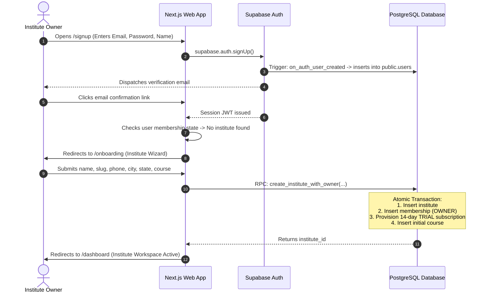
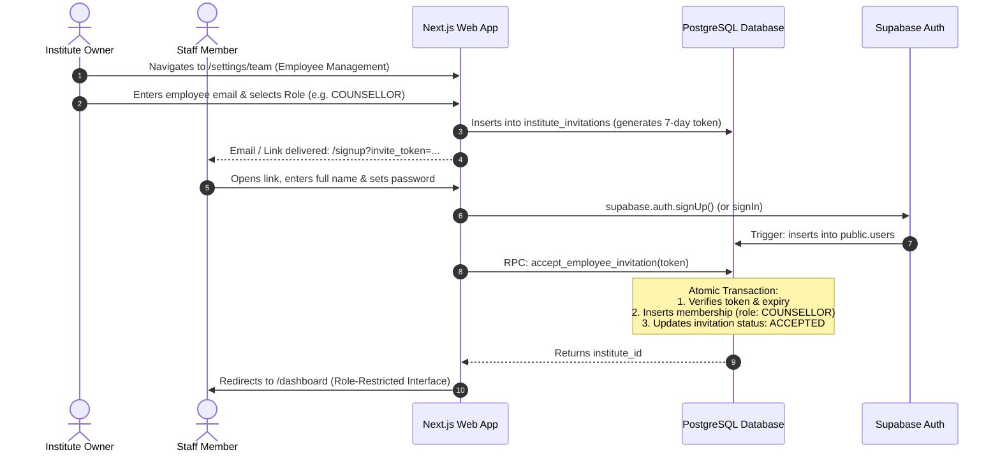

# Phase 1 Final Implementation Baseline & Architectural Specification

**Document Identifier:** `PHASE_1_FINAL_BASELINE.md`  
**Document Version:** 1.0.0 (Locked Implementation Baseline)  
**Creation Date:** November 10, 2026  
**Auditor & Authoring Roles:** Senior Technical Project Manager, Software Architect, Product Manager, Engineering Lead  
**Scope:** Phase 1 (Foundation, Multi-Tenancy, Authentication, Onboarding & Employee Account Management)  
**Status:** **READY FOR EXECUTION (AWAITING FORMAL USER CODING APPROVAL)**

---

## 1. Approved Product Decisions (Baseline Locks)

The following foundational decisions have been formally approved by the Product Owner and are permanently locked into the Phase 1 engineering baseline:

```
+-------------------------------------------------------------------------------------------------------------------+
| DECISION ID | TOPIC                      | APPROVED IMPLEMENTATION SPECIFICATION                                  |
+-------------+----------------------------+------------------------------------------------------------------------+
| DEC-01      | Institute Registration     | Self-service signup with mandatory email verification. Automatic       |
|             | & Onboarding               | 14-day free trial provisioned. Atomic execution of institute creation, |
|             |                            | owner role assignment, and trial subscription via a PostgreSQL RPC.   |
+-------------+----------------------------+------------------------------------------------------------------------+
| DEC-02      | User Account &             | For the MVP, one user account manages one institute at a time. The     |
|             | Multi-Tenancy Scope        | database uses composite uniqueness: UNIQUE (institute_id, user_id).   |
|             |                            | No rigid single-column constraints; future multi-institute support is  |
|             |                            | enabled with zero destructive schema migrations.                       |
+-------------+----------------------------+------------------------------------------------------------------------+
| DEC-12      | Institute Branches &       | For the MVP, each institute operates from a single center. The         |
|             | Hierarchy                  | institutes table includes an extensible parent_institute_id foreign    |
|             |                            | key to enable multi-branch hierarchies in Phase 3 without schema loss.  |
+-------------+----------------------------+------------------------------------------------------------------------+
```

---

## 2. Final Phase 1 Database Architecture

The Phase 1 database schema establishes the multi-tenant foundation, user identities, employee invitations, role-based access control, academic courses, and trial subscriptions.

### 2.1 Entity Relationship Diagram (Phase 1 Subsystem)

```mermaid
erDiagram
    INSTITUTES ||--o{ INSTITUTES : "parent_institute (future branches)"
    INSTITUTES ||--o{ INSTITUTE_MEMBERSHIPS : employs
    USERS ||--o{ INSTITUTE_MEMBERSHIPS : holds
    INSTITUTES ||--o{ INSTITUTE_INVITATIONS : issues
    USERS ||--o{ INSTITUTE_INVITATIONS : creates
    INSTITUTES ||--o{ COURSES : offers
    INSTITUTES ||--|| SUBSCRIPTIONS : entitles

    INSTITUTES {
        uuid id PK
        uuid parent_institute_id FK "nullable self-reference"
        text name
        text slug UK
        text phone
        text city
        text state
        text logo_url
        timestamptz created_at
        timestamptz updated_at
    }

    USERS {
        uuid id PK "references auth.users(id)"
        text email UK
        text full_name
        text phone
        timestamptz created_at
        timestamptz updated_at
    }

    INSTITUTE_MEMBERSHIPS {
        uuid id PK
        uuid institute_id FK
        uuid user_id FK
        text role "OWNER | ADMIN | COUNSELLOR | MARKETER | FACULTY"
        text status "ACTIVE | INVITED | SUSPENDED"
        boolean is_default
        timestamptz created_at
        timestamptz updated_at
    }

    INSTITUTE_INVITATIONS {
        uuid id PK
        uuid institute_id FK
        uuid invited_by FK
        text email
        text role "ADMIN | COUNSELLOR | MARKETER | FACULTY"
        text token UK
        text status "PENDING | ACCEPTED | EXPIRED | REVOKED"
        timestamptz expires_at
        timestamptz created_at
    }

    COURSES {
        uuid id PK
        uuid institute_id FK
        text name
        text exam_category "JEE | NEET | MHT_CET | UPSC | FOUNDATION | OTHER"
        numeric base_fee
        boolean is_active
        timestamptz created_at
    }

    SUBSCRIPTIONS {
        uuid id PK
        uuid institute_id FK UK
        text plan_tier "STARTER | GROWTH | PROFESSIONAL"
        text razorpay_subscription_id UK
        text status "TRIAL | ACTIVE | PAST_DUE | RESTRICTED | CANCELLED"
        timestamptz current_period_start
        timestamptz current_period_end
        timestamptz grace_until
        timestamptz created_at
    }
```

---

### 2.2 Complete Phase 1 DDL & Constraints Specification

```sql
-- ============================================================================
-- 1. Institutes Table (Root Tenant Entity)
-- ============================================================================
CREATE TABLE IF NOT EXISTS public.institutes (
    id UUID PRIMARY KEY DEFAULT gen_random_uuid(),
    parent_institute_id UUID REFERENCES public.institutes(id) ON DELETE CASCADE, -- Extensible multi-branch hierarchy (DEC-12)
    name TEXT NOT NULL,
    slug TEXT UNIQUE NOT NULL CHECK (slug ~ '^[a-z0-9]+(?:-[a-z0-9]+)*$' AND length(slug) BETWEEN 3 AND 48),
    phone TEXT NOT NULL,
    city TEXT NOT NULL,
    state TEXT NOT NULL,
    logo_url TEXT,
    created_at TIMESTAMPTZ DEFAULT now() NOT NULL,
    updated_at TIMESTAMPTZ DEFAULT now() NOT NULL
);

CREATE INDEX IF NOT EXISTS idx_institutes_slug ON public.institutes(slug);
CREATE INDEX IF NOT EXISTS idx_institutes_parent ON public.institutes(parent_institute_id);

-- ============================================================================
-- 2. Public User Profiles Table (Synchronized with auth.users)
-- ============================================================================
CREATE TABLE IF NOT EXISTS public.users (
    id UUID PRIMARY KEY REFERENCES auth.users(id) ON DELETE CASCADE,
    email TEXT UNIQUE NOT NULL,
    full_name TEXT NOT NULL,
    phone TEXT,
    created_at TIMESTAMPTZ DEFAULT now() NOT NULL,
    updated_at TIMESTAMPTZ DEFAULT now() NOT NULL
);

-- ============================================================================
-- 3. Institute Memberships Table (Multi-Tenancy Join & RBAC)
-- ============================================================================
CREATE TABLE IF NOT EXISTS public.institute_memberships (
    id UUID PRIMARY KEY DEFAULT gen_random_uuid(),
    institute_id UUID NOT NULL REFERENCES public.institutes(id) ON DELETE CASCADE,
    user_id UUID NOT NULL REFERENCES public.users(id) ON DELETE CASCADE,
    role TEXT NOT NULL CHECK (role IN ('OWNER', 'ADMIN', 'COUNSELLOR', 'MARKETER', 'FACULTY')),
    status TEXT NOT NULL DEFAULT 'ACTIVE' CHECK (status IN ('ACTIVE', 'INVITED', 'SUSPENDED')),
    is_default BOOLEAN DEFAULT true NOT NULL,
    created_at TIMESTAMPTZ DEFAULT now() NOT NULL,
    updated_at TIMESTAMPTZ DEFAULT now() NOT NULL,
    UNIQUE (institute_id, user_id) -- Future-proof composite uniqueness (DEC-02)
);

CREATE INDEX IF NOT EXISTS idx_memberships_institute ON public.institute_memberships(institute_id);
CREATE INDEX IF NOT EXISTS idx_memberships_user ON public.institute_memberships(user_id);

-- ============================================================================
-- 4. Employee Invitations Table (Secure Tokenized Onboarding)
-- ============================================================================
CREATE TABLE IF NOT EXISTS public.institute_invitations (
    id UUID PRIMARY KEY DEFAULT gen_random_uuid(),
    institute_id UUID NOT NULL REFERENCES public.institutes(id) ON DELETE CASCADE,
    invited_by UUID NOT NULL REFERENCES public.users(id) ON DELETE CASCADE,
    email TEXT NOT NULL,
    role TEXT NOT NULL CHECK (role IN ('ADMIN', 'COUNSELLOR', 'MARKETER', 'FACULTY')),
    token TEXT UNIQUE NOT NULL,
    status TEXT NOT NULL DEFAULT 'PENDING' CHECK (status IN ('PENDING', 'ACCEPTED', 'EXPIRED', 'REVOKED')),
    expires_at TIMESTAMPTZ NOT NULL DEFAULT (now() + INTERVAL '7 days'),
    created_at TIMESTAMPTZ DEFAULT now() NOT NULL
);

CREATE INDEX IF NOT EXISTS idx_invitations_token ON public.institute_invitations(token);
CREATE INDEX IF NOT EXISTS idx_invitations_email ON public.institute_invitations(email);

-- ============================================================================
-- 5. Courses Table (Institute Offerings)
-- ============================================================================
CREATE TABLE IF NOT EXISTS public.courses (
    id UUID PRIMARY KEY DEFAULT gen_random_uuid(),
    institute_id UUID NOT NULL REFERENCES public.institutes(id) ON DELETE CASCADE,
    name TEXT NOT NULL,
    exam_category TEXT NOT NULL CHECK (exam_category IN ('JEE', 'NEET', 'MHT_CET', 'UPSC', 'FOUNDATION', 'OTHER')),
    base_fee NUMERIC(10,2) NOT NULL DEFAULT 0.00 CHECK (base_fee >= 0),
    is_active BOOLEAN DEFAULT true NOT NULL,
    created_at TIMESTAMPTZ DEFAULT now() NOT NULL,
    updated_at TIMESTAMPTZ DEFAULT now() NOT NULL
);

CREATE INDEX IF NOT EXISTS idx_courses_institute ON public.courses(institute_id);

-- ============================================================================
-- 6. Subscriptions Table (SaaS Entitlements & Trial Lifecycle)
-- ============================================================================
CREATE TABLE IF NOT EXISTS public.subscriptions (
    id UUID PRIMARY KEY DEFAULT gen_random_uuid(),
    institute_id UUID UNIQUE NOT NULL REFERENCES public.institutes(id) ON DELETE CASCADE,
    plan_tier TEXT NOT NULL DEFAULT 'STARTER' CHECK (plan_tier IN ('STARTER', 'GROWTH', 'PROFESSIONAL')),
    razorpay_subscription_id TEXT UNIQUE,
    status TEXT NOT NULL DEFAULT 'TRIAL' CHECK (status IN ('TRIAL', 'ACTIVE', 'PAST_DUE', 'RESTRICTED', 'CANCELLED')),
    current_period_start TIMESTAMPTZ NOT NULL DEFAULT now(),
    current_period_end TIMESTAMPTZ NOT NULL DEFAULT (now() + INTERVAL '14 days'),
    grace_until TIMESTAMPTZ DEFAULT (now() + INTERVAL '21 days'),
    created_at TIMESTAMPTZ DEFAULT now() NOT NULL,
    updated_at TIMESTAMPTZ DEFAULT now() NOT NULL
);
```

---

### 2.3 Database Triggers & Stored Procedures

#### 1. User Profile Auto-Sync Trigger (`handle_new_user`)
```sql
CREATE OR REPLACE FUNCTION public.handle_new_user()
RETURNS TRIGGER AS $$
BEGIN
    INSERT INTO public.users (id, email, full_name)
    VALUES (
        NEW.id,
        NEW.email,
        COALESCE(NEW.raw_user_meta_data->>'full_name', split_part(NEW.email, '@', 1))
    )
    ON CONFLICT (id) DO UPDATE 
    SET email = EXCLUDED.email,
        full_name = COALESCE(EXCLUDED.full_name, public.users.full_name),
        updated_at = now();
    RETURN NEW;
END;
$$ LANGUAGE plpgsql SECURITY DEFINER;

DROP TRIGGER IF EXISTS on_auth_user_created ON auth.users;
CREATE TRIGGER on_auth_user_created
    AFTER INSERT ON auth.users
    FOR EACH ROW EXECUTE FUNCTION public.handle_new_user();
```

#### 2. Atomic Institute Onboarding Function (`create_institute_with_owner`)
```sql
CREATE OR REPLACE FUNCTION public.create_institute_with_owner(
    p_name TEXT,
    p_slug TEXT,
    p_phone TEXT,
    p_city TEXT,
    p_state TEXT,
    p_logo_url TEXT DEFAULT NULL,
    p_default_course TEXT DEFAULT NULL,
    p_exam_category TEXT DEFAULT 'OTHER'
)
RETURNS UUID AS $$
DECLARE
    v_institute_id UUID;
    v_user_id UUID;
    v_clean_slug TEXT;
BEGIN
    v_user_id := auth.uid();
    IF v_user_id IS NULL THEN
        RAISE EXCEPTION 'Authentication required: caller must be an authenticated user.';
    END IF;

    -- Clean and validate slug
    v_clean_slug := lower(trim(p_slug));
    IF v_clean_slug IN ('admin', 'api', 'auth', 'login', 'signup', 'dashboard', 'inquire', 'pricing', 'terms', 'privacy', 'billing', 'contact', 'settings') THEN
        RAISE EXCEPTION 'The slug "%" is reserved for platform system routes.', v_clean_slug;
    END IF;

    -- Check if user already owns an institute (MVP Rule)
    IF EXISTS (
        SELECT 1 FROM public.institute_memberships 
        WHERE user_id = v_user_id AND role = 'OWNER'
    ) THEN
        RAISE EXCEPTION 'User already owns an active institute workspace.';
    END IF;

    -- Step 1: Insert Institute
    INSERT INTO public.institutes (name, slug, phone, city, state, logo_url)
    VALUES (p_name, v_clean_slug, p_phone, p_city, p_state, p_logo_url)
    RETURNING id INTO v_institute_id;

    -- Step 2: Bind Caller as OWNER
    INSERT INTO public.institute_memberships (institute_id, user_id, role, status, is_default)
    VALUES (v_institute_id, v_user_id, 'OWNER', 'ACTIVE', true);

    -- Step 3: Provision 14-Day Free Trial Subscription
    INSERT INTO public.subscriptions (
        institute_id, plan_tier, status, current_period_start, current_period_end, grace_until
    )
    VALUES (
        v_institute_id, 'STARTER', 'TRIAL', now(), now() + INTERVAL '14 days', now() + INTERVAL '21 days'
    );

    -- Step 4: Optionally provision initial course
    IF p_default_course IS NOT NULL AND length(trim(p_default_course)) > 0 THEN
        INSERT INTO public.courses (institute_id, name, exam_category, base_fee)
        VALUES (v_institute_id, trim(p_default_course), p_exam_category, 0.00);
    END IF;

    RETURN v_institute_id;
END;
$$ LANGUAGE plpgsql SECURITY DEFINER;
```

#### 3. Employee Invitation Acceptance Function (`accept_employee_invitation`)
```sql
CREATE OR REPLACE FUNCTION public.accept_employee_invitation(
    p_token TEXT
)
RETURNS UUID AS $$
DECLARE
    v_invitation RECORD;
    v_user_id UUID;
BEGIN
    v_user_id := auth.uid();
    IF v_user_id IS NULL THEN
        RAISE EXCEPTION 'Authentication required: caller must be an authenticated user.';
    END IF;

    -- Validate invitation token
    SELECT * INTO v_invitation 
    FROM public.institute_invitations 
    WHERE token = p_token 
      AND status = 'PENDING' 
      AND expires_at > now();

    IF NOT FOUND THEN
        RAISE EXCEPTION 'Invalid, expired, or already accepted invitation token.';
    END IF;

    -- Create Membership
    INSERT INTO public.institute_memberships (
        institute_id, user_id, role, status, is_default
    )
    VALUES (
        v_invitation.institute_id, v_user_id, v_invitation.role, 'ACTIVE', true
    )
    ON CONFLICT (institute_id, user_id) DO UPDATE 
    SET role = EXCLUDED.role, status = 'ACTIVE', updated_at = now();

    -- Mark Invitation as ACCEPTED
    UPDATE public.institute_invitations 
    SET status = 'ACCEPTED' 
    WHERE id = v_invitation.id;

    RETURN v_invitation.institute_id;
END;
$$ LANGUAGE plpgsql SECURITY DEFINER;
```

---

## 3. Authentication & Institute Onboarding Workflow



---

## 4. Employee Invitation & Role Management Workflow



---

## 5. Security & Non-Recursive Row Level Security (RLS)

### 5.1 Helper Functions (No Policy Recursion)
```sql
CREATE OR REPLACE FUNCTION public.get_user_institutes(p_user_id UUID)
RETURNS TABLE (institute_id UUID) AS $$
    SELECT m.institute_id 
    FROM public.institute_memberships m 
    WHERE m.user_id = p_user_id 
      AND m.status = 'ACTIVE';
$$ LANGUAGE sql SECURITY DEFINER STABLE;

CREATE OR REPLACE FUNCTION public.get_user_role(p_user_id UUID, p_institute_id UUID)
RETURNS TEXT AS $$
    SELECT m.role 
    FROM public.institute_memberships m 
    WHERE m.user_id = p_user_id 
      AND m.institute_id = p_institute_id 
      AND m.status = 'ACTIVE'
    LIMIT 1;
$$ LANGUAGE sql SECURITY DEFINER STABLE;
```

### 5.2 RLS Policies Summary
- **`institutes` Table:**
  - Public can view basic profile for `/inquire/[slug]` page (`USING (true)`).
  - Members can view full record (`USING (id IN (SELECT get_user_institutes(auth.uid())))`).
  - Only `OWNER` or `ADMIN` can update profile.
- **`users` Table:**
  - Users view and update their own record (`USING (id = auth.uid())`).
  - Fellow team members within the same institute can view team names and emails.
- **`institute_memberships` Table:**
  - Members view team roster of their own institute (`USING (institute_id IN (SELECT get_user_institutes(auth.uid())))`).
  - Only `OWNER` or `ADMIN` can insert invitations or remove non-owners.
- **`institute_invitations` Table:**
  - `OWNER` and `ADMIN` can view and manage invitations for their institute.
  - Public can validate a token during invitation signup.
- **`courses` Table:**
  - Public can view active courses on public inquiry forms.
  - Members view all institute courses.
  - Only `OWNER` and `ADMIN` can insert, update, or deactivate courses.
- **`subscriptions` Table:**
  - Viewable strictly by `OWNER` and `ADMIN` for their institute.
  - Mutated strictly by service role (Edge Functions / Webhooks).

---

## 6. Phase 1 Implementation Sequence

The implementation sequence for Phase 1 follows a strict, non-blocking critical path:

```
[Step 1: TSK-FND-001 - Next.js 14+ Scaffold + Tailwind UI Tokens]
                         ↓
[Step 2: TSK-FND-002 - Supabase SSR Context & Session Middleware]
                         ↓
[Step 3: TSK-DB-001 - PostgreSQL Core DDL, Triggers, & RPCs]
                         ↓
[Step 4: TSK-DB-002 - Multi-Tenant RLS Policies & Security Helpers]
                         ↓
            ┌────────────┴────────────┐
            ↓                         ↓
[Step 5: TSK-AUTH-001 - Auth Views]  [Step 6: TSK-UI-001 - App Shell & Sidebar]
            ↓                         ↓
[Step 7: TSK-AUTH-002 - Institute Onboarding Wizard]
            ↓
[Step 8: TSK-AUTH-003 - Employee Management & Invitation Flow]
            ↓
[Step 9: TSK-SEC-001 - Automated RLS Multi-Tenant Security Audit]
```

---

## 7. Task-Level Acceptance Criteria

| Task ID | Task Deliverable | Acceptance Criteria |
|---|---|---|
| `TSK-FND-001` | Next.js App Router Scaffold | `pnpm build` completes with zero errors; Tailwind tokens `#0B4F49` and `#F7F8F6` render correctly. |
| `TSK-FND-002` | Supabase SSR Helpers | Middleware refreshes sessions from cookies; server components access authenticated user. |
| `TSK-DB-001` | PostgreSQL Schema & RPCs | All 6 tables instantiate; `handle_new_user` triggers on auth insert; `create_institute_with_owner` executes atomically. |
| `TSK-DB-002` | Multi-Tenant RLS Policies | Non-recursive policies active; cross-tenant queries return zero rows. |
| `TSK-AUTH-001` | Auth Views (`/login`, `/signup`) | Split-screen layout renders; mobile viewports stack cleanly; inputs enforce $\ge 16\text{px}$. |
| `TSK-AUTH-002` | Institute Onboarding Wizard | Onboarding form validates slugs; creates institute, owner membership, and 14-day trial in one transaction. |
| `TSK-UI-001` | App Shell & Responsive Sidebar | 240px desktop sidebar with active indicators; collapses to touch-friendly hamburger drawer below 768px. |
| `TSK-AUTH-003` | Employee Account Management | Owner invites staff with role selection; invitee sets password via token link and logs in with role boundaries. |
| `TSK-SEC-001` | Multi-Tenant RLS Security Test | Automated test proves User A from Institute 1 receives 0 rows when attempting to query Institute 2 data. |

---

## 8. Remaining Blockers

**REMAINING BLOCKERS FOR PHASE 1: NONE.**

All architectural, security, database, and functional ambiguities have been resolved and codified into this baseline document.

---

## 9. Final Phase 1 Readiness Status

### Status: **READY**

The project is fully specified, architecturally reconciled, and completely unblocked. Implementation of Phase 1 can begin immediately upon your final instruction.

---
*End of Phase 1 Final Implementation Baseline (`PHASE_1_FINAL_BASELINE.md`).*

